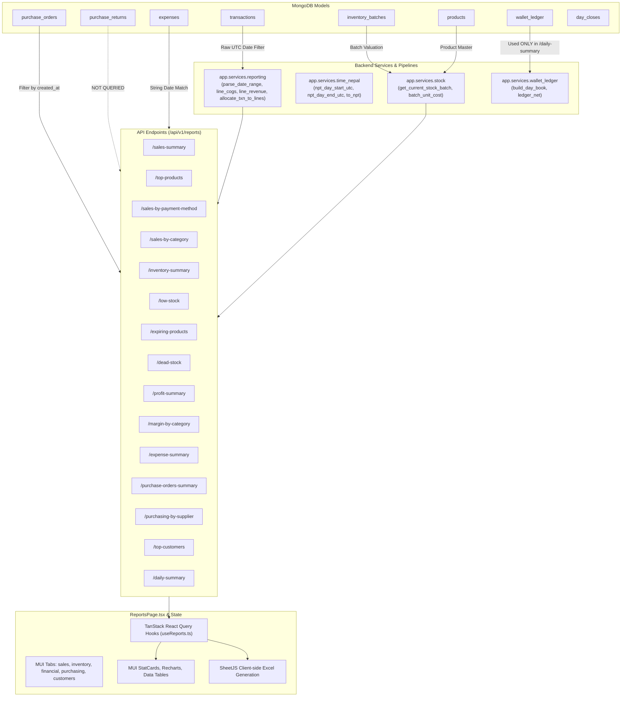

# KoMart Reports Module — Comprehensive Audit & Current-State Analysis

**Document Version:** 1.0.0  
**Audit Date:** October 2026  
**Auditors:** Senior Product Manager, Retail Accounting Analyst, Senior Full-Stack Developer, Lead QA Engineer  
**Scope:** KoMart Retail Management System — Reports Module (Frontend, Backend, Database Models, Ledger Services, Excel Export)

---

## 1. Executive Summary

KoMart is a fast-paced retail supermarket operating in Nepal. A thorough, line-by-line audit of the Reports module (`frontend/src/pages/reports/ReportsPage.tsx`, `backend/app/routers/reports.py`, `backend/app/services/reporting.py`, and supporting models/services) was conducted to evaluate data accuracy, retail accounting coverage, UI/export consistency, and architectural soundness.

### Key Finding
While KoMart has advanced underlying subsystems—including a double-entry wallet ledger (`WalletLedgerEntry`), FEFO batch-level costing (`InventoryBatch`), Nepal timezone resolution (`Asia/Kathmandu`), and purchase return tracking—the **Reports module is critically disconnected from these subsystems**. 

### Critical Accounting & Calculation Defects Identified
1. **Double-Counting of Inventory Cost in Net Profit (P0):** Supplier payments for Purchase Orders (`category="purchase_order"`) are categorized as Operating Expenses. Net Profit subtracts both COGS (when inventory is sold) and Supplier Payments (when inventory is paid for), severely understating business profit.
2. **COGS Understatement & Gross Profit Inflation on Pack Sales (P0):** When products with a multi-unit factor (`unit_factor > 1`, e.g., pack of 12) are sold, `line_cogs` multiplies unit cost by pack quantity without multiplying by `unit_factor`. COGS is understated by 10x–50x on pack sales, reporting false gross margins of 85–95%.
3. **Nepal Timezone Boundary Shift (P0):** Reports parse dates as UTC midnight rather than Nepal midnight (`UTC+5:45`). Morning transactions between 00:00 and 05:45 NPT are omitted from reporting dates, and the next day's morning transactions are wrongly rolled back. Sales list pages and Reports show differing revenue for the same calendar date.
4. **Broken Low Stock Pagination (P0):** Pagination (`.skip().limit()`) is executed in MongoDB across *all catalog products* before filtering for low stock in Python. Pages frequently return empty data with total page counts in the hundreds, and Excel exports silently omit low-stock items past product 1000.
5. **Purchase Returns & Supplier Credits 100% Omitted (P1):** The entire `PurchaseReturn` subsystem is ignored in Reports. Net purchases, supplier refunds received, and open receivables are absent.
6. **Unallocated Bill Discounts & Synthetic UI Rows (P1):** Product-level sales exclude cart, promo, and loyalty discounts, forcing a confusing synthetic reconciliation row in the table and Excel export.
7. **Inventory Valuation Inconsistency (P1):** Total inventory value uses batch unit costs, but category breakdown uses catalog static cost price, causing the category breakdown sum to disagree with the total card.
8. **Dead Stock Includes Voided Sales (P1):** Dead stock queries do not filter out voided transactions, masking stale stock.
9. **Excel Export Flaws (P1):** Disparate tables are stacked vertically in single sheets with misaligned column widths; no dynamic Excel formulas (`=SUM()`); no cell number formatting; silent failures on API errors.
10. **Missing Cash Flow & True Retail Financial Statements (P1):** No Cash Flow Statement, No Collections vs Sales reconciliation, and No Accounts Payable aging.

---

## 2. Current Reports Page Inventory

### 2.1 Route & Access Control
- **Frontend Route:** `/reports` (rendered by [ReportsPage.tsx](file:///g:/Vibe%20Coding/KoMart/frontend/src/pages/reports/ReportsPage.tsx))
- **Day Cash Book Route:** `/reports/daily` (rendered by [DailyReportPage.tsx](file:///g:/Vibe%20Coding/KoMart/frontend/src/pages/reports/DailyReportPage.tsx))
- **Role Guard:** Restricted to `admin` and `manager` roles (`RoleGuard allow={['admin', 'manager']}`). Cashier-level performance reports are further restricted to `admin` only.

### 2.2 Tab Structure & Visual Components

| Tab | Component / Section | Data Source (Endpoint) | Metrics / Visuals |
|---|---|---|---|
| **Sales** | Stat Cards (4) | `/reports/sales-summary`, `/reports/revenue` | Total Revenue, Avg. Daily Revenue, Best Day, Transactions & Avg Basket |
| | Revenue Over Time | `/reports/revenue` | Area chart (Daily revenue across selected range) |
| | Sales by Payment Method | `/reports/sales-by-payment-method` | Pie chart with count & revenue per payment method |
| | Sales by Category | `/reports/sales-by-category` | Pie chart of category share |
| | Sales by Hour | `/reports/sales-by-hour` | Bar chart (24 hours, 00:00 to 23:00) |
| | Sales by Day of Week | `/reports/sales-by-day-of-week` | Bar chart (Mon to Sun) |
| | Items Sold Table | `/reports/top-products?limit=5000` | Paginated table (S.N, Product, Price, Units Sold, Line Total, Discount, Revenue) + Synthetic Bill Adjust row |
| | Sales by Cashier Table | `/reports/sales-by-cashier` | Cashier, Transactions, Revenue (Admin only) |
| **Inventory** | Stat Cards (5) | `/reports/inventory-summary` | Total SKUs, Inventory Value, Low Stock, Out of Stock, Expiring Soon |
| | Stock Value by Category | `/reports/inventory-summary` | Horizontal bar chart of stock value per category |
| | Low & Out of Stock | `/reports/low-stock?stock_filter=both` | Table (Top 10 low/out of stock items) |
| | Expiring Soon | `/reports/expiring-products?within_days=30` | Table (Batches expiring within 30 days) |
| | Dead Stock | `/reports/dead-stock?days=30` | Table (Products with stock but no sales in 30 days) |
| **Financial** | Stat Cards (7) | `/reports/profit-summary`, `/reports/expense-summary` | Total Revenue, Gross Profit, Gross Margin %, Total Expenses, Operating Expenses, Setup Investment, Net Profit |
| | Revenue Trend | `/reports/profit-summary` | Area chart (Daily revenue - *duplicate of Sales tab chart*) |
| | Daily Expense Trend | `/reports/expense-summary` | Area chart (Daily expense amounts) |
| | Margin by Category | `/reports/margin-by-category` | Table (Category, Revenue, Gross Profit, Margin %) |
| | Expenses by Category | `/reports/expense-summary` | Horizontal bar chart of expense category amounts |
| | Expense Breakdown | `/reports/expense-summary` | Table (Category, Count, Amount, Total) |
| **Purchasing** | Stat Cards (2) + Status Chips | `/reports/purchase-orders-summary` | Total POs, Total Spend, PO status breakdown |
| | Spend by Supplier | `/reports/purchasing-by-supplier` | Horizontal bar chart of supplier spend |
| **Customers** | Stat Cards (4) | `/reports/loyalty-summary` | Total Members, Active Members, New Customers, Points Redeemed |
| | Top Customers Table | `/reports/top-customers?limit=10` | Table (Customer, Transactions, Total Spent) |

### 2.3 Excel Export Current State
Export is client-side using `xlsx` (SheetJS) triggered by "Export All":
- Generates a 5-sheet workbook: `'Sales'`, `'Inventory'`, `'Financial'`, `'Purchasing'`, `'Customers'`.
- Parallel API fetches via `Promise.all` with `.catch(() => null)`.
- Concatenates multiple disparate sections into single Array-of-Arrays (AoA) sheets.

---

## 3. Data Flow Tracing



---

## 4. Confirmed Accuracy Defects & Accounting Deficiencies

### Defect 1: Double-Counting Inventory in Net Operating Profit (P0 — Critical)
- **Code Locations:** 
  - [backend/app/routers/reports.py:822-836](file:///g:/Vibe%20Coding/KoMart/backend/app/routers/reports.py#L822-L836)
  - [backend/app/services/expense_helpers.py:15-16](file:///g:/Vibe%20Coding/KoMart/backend/app/services/expense_helpers.py#L15-L16)
  - [frontend/src/pages/reports/ReportsPage.tsx:293-296](file:///g:/Vibe%20Coding/KoMart/frontend/src/pages/reports/ReportsPage.tsx#L293-L296)
  - [frontend/src/pages/reports/ReportsPage.tsx:1267-1272](file:///g:/Vibe%20Coding/KoMart/frontend/src/pages/reports/ReportsPage.tsx#L1267-L1272)
- **Verified Code:**
  ```python
  # reports.py line 822
  for expense in expenses:
      total_expenses += expense.amount
      if is_setup_investment(expense):
          setup_investment += expense.amount
  ...
  operating_expenses = round(total_expenses - setup_investment, 2)
  ```
  ```typescript
  // ReportsPage.tsx line 1267
  Net Profit = Gross Profit - Operating Expenses
  ```
- **Actual Behavior:** 
  When a Purchase Order payment is recorded in `po_payment.py`, it inserts an `Expense` with `category="purchase_order"`. In `reports.py`, `operating_expenses` only subtracts `setup_investment`. It **does not exclude PO payments**.
  In the UI, Net Profit = Gross Profit − Operating Expenses.
  Gross Profit already subtracts inventory cost via COGS. Subtracting supplier payments in Operating Expenses deducts inventory cost a second time!
- **Business Impact:** Net profit is heavily distorted. A store that purchases Rs. 500,000 of inventory and sells Rs. 200,000 shows an artificial catastrophic operating loss, completely confusing store owners and accountants.
- **Recommended Correction:** Exclude `purchase_order` payments (and any expense with `purchase_order_id`) from Operating Expenses in P&L reporting. Track PO payments strictly as Cash Outflows / Payables Settlements.

---

### Defect 2: COGS Understatement on Multi-Unit / Pack Products (P0 — Critical)
- **Code Locations:**
  - [backend/app/services/reporting.py:87-93](file:///g:/Vibe%20Coding/KoMart/backend/app/services/reporting.py#L87-L93)
  - [backend/app/routers/reports.py:494](file:///g:/Vibe%20Coding/KoMart/backend/app/routers/reports.py#L494)
  - [backend/app/routers/reports.py:543](file:///g:/Vibe%20Coding/KoMart/backend/app/routers/reports.py#L543)
- **Verified Code:**
  ```python
  # reporting.py line 87
  def line_cogs(item: TransactionItem, product: Product | None) -> float:
      unit_cost = getattr(item, "unit_cost", 0.0) or 0.0
      if unit_cost > 0:
          return unit_cost * item.quantity
      if product:
          return product.cost_price * item.quantity
      return 0.0
  ```
- **Actual Behavior:**
  In POS sales (`sales.py`), when a pack or case is sold (e.g., carton of 24 pieces, `quantity = 1`, `unit_factor = 24`), `item.unit_cost` stores the cost per base piece (e.g. Rs. 20).
  In `sales.py:353`, total transaction cost is correctly computed as `sum(i.unit_cost * _base_quantity(i))` (where `_base_quantity = item.quantity * unit_factor` = 24 × Rs. 20 = Rs. 480).
  However, `line_cogs` in `reporting.py` calculates `unit_cost * item.quantity` = `20 * 1 = Rs. 20`!
  It completely ignores `unit_factor` (`item.unit_factor` or `product.units_per_buy_uom`).
- **Business Impact:** COGS for all carton/pack sales is undercounted by a factor of 12x, 24x, or 48x. Gross profit is grossly inflated, and gross margin shows 85–95% on items where the store only makes 10–15%.
- **Recommended Correction:** Use `txn.total_cost` (already stored on `Transaction`) for transaction-level profit, and update `line_cogs` to multiply by base units: `unit_cost * item.quantity * max(1, getattr(item, 'unit_factor', 1) or 1)`.

---

### Defect 3: Nepal Timezone & Date Boundary Omissions (P0 — Critical)
- **Code Locations:**
  - [backend/app/services/reporting.py:17-26](file:///g:/Vibe%20Coding/KoMart/backend/app/services/reporting.py#L17-L26)
  - [backend/app/routers/reports.py:141-145](file:///g:/Vibe%20Coding/KoMart/backend/app/routers/reports.py#L141-L145)
  - [backend/app/routers/reports.py:493](file:///g:/Vibe%20Coding/KoMart/backend/app/routers/reports.py#L493)
  - [backend/app/services/reporting.py:145](file:///g:/Vibe%20Coding/KoMart/backend/app/services/reporting.py#L145)
- **Verified Code:**
  ```python
  # reporting.py line 17
  def parse_date_range(start_date: str, end_date: str) -> tuple[datetime, datetime]:
      now = datetime.now(timezone.utc)
      start = datetime.fromisoformat(start_date) if start_date else now - timedelta(days=30)
      if start.tzinfo is None:
          start = start.replace(tzinfo=timezone.utc)
      end = datetime.fromisoformat(end_date) if end_date else now
      if end.tzinfo is None:
          end = end.replace(tzinfo=timezone.utc)
      end = end.replace(hour=23, minute=59, second=59, microsecond=999999)
      return start, end
  ```
- **Actual Behavior:**
  Nepal is UTC+5:45 (`Asia/Kathmandu`).
  `start_date="2026-10-18"` parses to `2026-10-18 00:00:00 UTC`, which corresponds to `05:45 AM` in Nepal!
  Any transaction recorded between 00:00 AM and 05:45 AM Nepal time (UTC 18:15 to 23:59 the previous evening) is **omitted**.
  Conversely, transactions up to 05:45 AM on October 19 are **wrongly included** in October 18!
  In addition, `profit_summary_report` groups daily totals with `txn.created_at.strftime("%Y-%m-%d")` (UTC date), and Mongo aggregation in `aggregate_sales_by_day` uses `$dateToString` without the `"timezone": "Asia/Kathmandu"` parameter.
- **Business Impact:** Reports total does not reconcile with the POS Sales page (which uses `npt_day_start_utc` and `npt_day_end_utc`). Daily trend charts misattribute evening sales.
- **Recommended Correction:** Standardize date range parsing across all reporting endpoints using `npt_day_start_utc(start_date)` and `npt_day_end_utc(end_date)`. Pass `timezone: "Asia/Kathmandu"` in MongoDB `$dateToString` operators and convert timestamps via `to_npt(dt)` before string formatting.

---

### Defect 4: Broken Pagination in Low Stock Report (P0 — Critical)
- **Code Locations:**
  - [backend/app/routers/reports.py:415-469](file:///g:/Vibe%20Coding/KoMart/backend/app/routers/reports.py#L415-L469)
  - [frontend/src/pages/reports/ReportsPage.tsx:252](file:///g:/Vibe%20Coding/KoMart/frontend/src/pages/reports/ReportsPage.tsx#L252)
- **Verified Code:**
  ```python
  # reports.py line 427
  total = await query.count()  # Count of ALL active products in catalog!
  products = await query.sort("name").skip((page - 1) * page_size).limit(page_size).to_list()
  ...
  for product in products:
      if stock_filter == "out" and stock != 0: continue
      elif stock_filter == "low" and (stock == 0 or stock > product.low_stock_threshold): continue
      rows.append(...)
  return PaginatedResponse(data=rows, total=total, ...)
  ```
- **Actual Behavior:**
  The endpoint paginates the *entire catalog* before filtering for low stock in memory. If page 1 (first 25 products) has no low-stock items, it returns `data = []` with `total = 5000` and `total_pages = 200`.
  In the Excel export, calling `getLowStock(1, 1000, 'both')` completely ignores any low-stock items that happen to fall beyond the first 1000 catalog items.
- **Business Impact:** Store managers and procurement staff cannot reliably see which products need reordering.
- **Recommended Correction:** Use MongoDB aggregation joining current batch stock or filter all low-stock items prior to pagination, returning the true count of low/out-of-stock items.

---

### Defect 5: Purchase Returns & Supplier Credits 100% Omitted (P1 — High)
- **Code Locations:** [backend/app/routers/reports.py:561-614](file:///g:/Vibe%20Coding/KoMart/backend/app/routers/reports.py#L561-L614)
- **Actual Behavior:**
  KoMart has a complete `PurchaseReturn` model (`purchase_returns` collection), supporting return modes (PO-linked, Supplier-linked) and settlement types (`refund`, `reduce_payable`, `stock_only`).
  Yet `reports.py` completely ignores `PurchaseReturn`:
  - `purchasing-by-supplier` reports Gross PO totals without deducting returns.
  - No report exists for Supplier Credit Notes or open requested refunds (Receivables).
  - Net Purchases cannot be determined.
- **Business Impact:** Supplier spend is overstated; store owners cannot see what suppliers owe them in uncollected refunds.
- **Recommended Correction:** Integrate `PurchaseReturn` into purchasing and financial summaries. Calculate Net Purchases = Gross Purchases − Purchase Returns. Add an open Supplier Receivables summary.

---

### Defect 6: Unallocated Bill Discounts & Synthetic UI Row (P1 — High)
- **Code Locations:**
  - [backend/app/routers/reports.py:276-314](file:///g:/Vibe%20Coding/KoMart/backend/app/routers/reports.py#L276-L314)
  - [frontend/src/pages/reports/ReportsPage.tsx:156-163, 334-345, 862-885](file:///g:/Vibe%20Coding/KoMart/frontend/src/pages/reports/ReportsPage.tsx#L156-L163)
- **Actual Behavior:**
  `top-products` (Items Sold) calculates line revenue as `price * qty - discount * qty`, while setting `bill_discount = 0.0`. Cart promotions, coupons, and loyalty point redemptions are excluded from product revenue.
  To make the table reconcile with `Total Revenue`, the frontend injects a synthetic reconciliation row:
  `"Bill discounts & round-off (Manual / promo / loyalty -X · Tax +Y · Round-off +Z)"`.
  This synthetic row is also written directly into the exported Excel spreadsheet.
  Ironically, [backend/app/services/reporting.py:50-84](file:///g:/Vibe%20Coding/KoMart/backend/app/services/reporting.py#L50-L84) already contains a helper `allocate_txn_to_lines` to proportionally distribute bill discounts, but it was never used in `top_products_report`.
- **Business Impact:** Skews product-level profit margins and creates an unprofessional report UI and export.
- **Recommended Correction:** Wire up `allocate_txn_to_lines` so each sold product displays its proportional bill discount and true Net Revenue. Provide clear columns: Gross Sales, Item Discounts, Allocated Bill Discounts, Net Sales.

---

### Defect 7: Inventory Valuation Method Inconsistency (P1 — High)
- **Code Locations:**
  - [backend/app/services/reporting.py:154-169](file:///g:/Vibe%20Coding/KoMart/backend/app/services/reporting.py#L154-L169)
  - [backend/app/services/reporting.py:266-288](file:///g:/Vibe%20Coding/KoMart/backend/app/services/reporting.py#L266-L288)
- **Actual Behavior:**
  In `inventory_summary_report`:
  - Card `inventory_value` is calculated from `InventoryBatch`: `sum(batch.quantity * batch.unit_cost)`.
  - Chart `by_category.stock_value` is calculated from `Product`: `sum(stock * product.cost_price)`.
  Because batch purchase costs change over time and differ from catalog master cost price, the category breakdown sum never equals the inventory summary card.
- **Business Impact:** Internal reporting contradiction. Auditors cannot reconcile category stock value with total stock value.
- **Recommended Correction:** Standardize category inventory valuation on active batch valuation (`InventoryBatch` grouped by product category), with fallback to catalog cost price only if a batch has zero unit cost.

---

### Defect 8: Dead Stock Queries Include Voided Sales (P1 — High)
- **Code Locations:** [backend/app/services/reporting.py:228-250](file:///g:/Vibe%20Coding/KoMart/backend/app/services/reporting.py#L228-L250)
- **Actual Behavior:**
  `aggregate_sold_product_ids` and `aggregate_last_sale_before` query `Transaction` without `status: {"$ne": "voided"}`. If an item was sold in a transaction that was later voided, it is considered "recently sold" and excluded from dead stock.
- **Business Impact:** Stale inventory remains undetected because a voided sale masked it.
- **Recommended Correction:** Add `{"status": {"$ne": TransactionStatus.voided.value}}` to both aggregation pipelines.

---

### Defect 9: Purchasing Reports Lack Invoice References & Bill Breakdown (P2 — Medium)
- **Code Locations:** [backend/app/routers/reports.py:561-614](file:///g:/Vibe%20Coding/KoMart/backend/app/routers/reports.py#L561-L614)
- **Actual Behavior:**
  `PurchaseOrder` stores `subtotal`, `discount`, `additional_charges` (transport/freight), `amount_paid`, `bill_number` (supplier bill no), and `received_date`.
  `purchasing-by-supplier` only returns `order_count` and `total_amount`.
  It provides zero visibility into:
  - Goods Received vs Ordered amounts.
  - Supplier bill numbers.
  - Freight/additional charges vs purchase discounts.
  - Amount paid vs outstanding accounts payable.
- **Business Impact:** Retailers cannot use the Purchasing report for supplier account reconciliation or tax audit trails.
- **Recommended Correction:** Expand purchasing summary and supplier breakdown to include: Gross PO, Discounts, Additional Charges, Net POs, Received POs, Amount Paid, and Outstanding Payables.

---

### Defect 10: Excel Export Structural and Formatting Deficiencies (P1 — High)
- **Code Locations:** [frontend/src/pages/reports/ReportsPage.tsx:221-538](file:///g:/Vibe%20Coding/KoMart/frontend/src/pages/reports/ReportsPage.tsx#L221-L538)
- **Actual Behavior:**
  1. Multiple tables stacked on one sheet (`salesAoA`) sharing a single column width setting, causing labels and numbers to wrap or clip.
  2. Zero Excel formulas: Grand totals are hardcoded JS calculations.
  3. No number/currency formatting: Cells contain unformatted floating point numbers or string percentages.
  4. Truncation: Hardcoded limits (`getTopCustomers(range, 50)`) silently truncate datasets.
  5. Silent failure: Data fetching wrapped in `.catch(() => null)`.
  6. Missing sheets: No Cash Flow or Payment Reconciliation sheet.
- **Business Impact:** Exported spreadsheets are not audit-ready or presentable to external accountants.

---

## 5. Potential Accounting Risks & Architecture Assessment

| Area | Current System Behavior | Accounting Risk | Severity |
|---|---|---|---|
| **Inventory Costing Method** | FEFO batch deduction at checkout; batch weighted cost saved to `item.unit_cost`. | Sound architecture, but reports bypass stored transaction costs and fall back to flawed calculations. | High |
| **Sales Revenue vs Collections** | Sales Tab presents Sales Revenue as performance. Day Cash Book tracks Cash/Wallet. Reports page has no cash reconciliation. | Managers treat sales revenue as available cash, leading to liquidity misjudgments. | High |
| **Accounts Payable** | Tracked in `PurchaseOrder.amount_paid` and `dashboard_kpi.total_payables()`. Omitted from Reports page. | Store managers cannot see total outstanding supplier debt by period. | High |
| **Accounts Receivable** | In KoMart, retail POS sales are paid immediately; Receivables are strictly open Supplier Refunds (`PurchaseReturn`). | Omitted from Reports page; unrefunded supplier returns are lost from accounting view. | Medium |
| **Tax & Round-Off** | Tax is 13% VAT where applicable; round-off handles fractional paisa. Recorded on `Transaction`. | Reports bundle tax and round-off into a synthetic discount adjustment row rather than proper ledger columns. | Medium |
| **Internal Consumption** | Recorded as `Expense` with `payment_method="inventory"`. Deducts stock via internal adjustment. | Must be clearly separated from cash expenses in cash flow and operating expense summaries. | Medium |

---

## 6. Audit Conclusion & Next Steps

The KoMart Reports module possesses sufficient underlying transaction data across transactions, batches, wallet ledger entries, and purchase orders. However, due to disconnected reporting queries, timezone mismatches, and mistaken accounting assumptions (especially treating supplier payments as operating expenses), the current reporting output is unreliable for financial decision-making.

The companion documents provide the full remediation blueprint:
1. [REPORTS_ACCOUNTING_DEFINITIONS.md](file:///g:/Vibe%20Coding/KoMart/REPORTS_ACCOUNTING_DEFINITIONS.md): Exact mathematical formulas, inclusion/exclusion criteria, and data sources.
2. [REPORTS_IMPROVEMENT_PLAN.md](file:///g:/Vibe%20Coding/KoMart/REPORTS_IMPROVEMENT_PLAN.md): Prioritized implementation blueprint, redesigned report structure, and API contract changes.
3. [REPORTS_TEST_STRATEGY.md](file:///g:/Vibe%20Coding/KoMart/REPORTS_TEST_STRATEGY.md): Comprehensive QA verification test suite and regression matrix.
