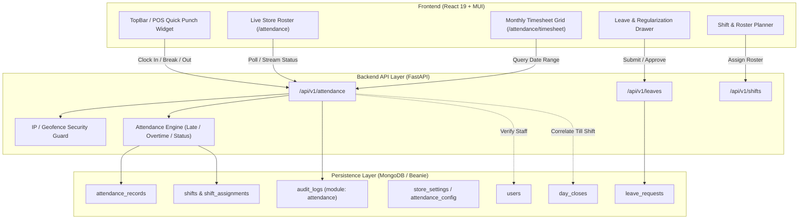
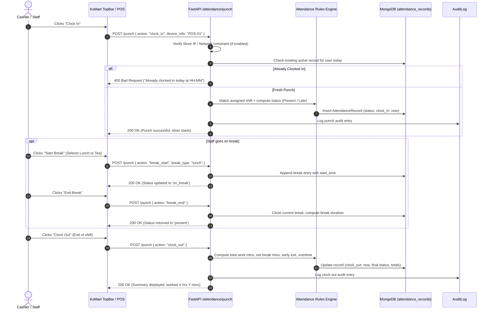
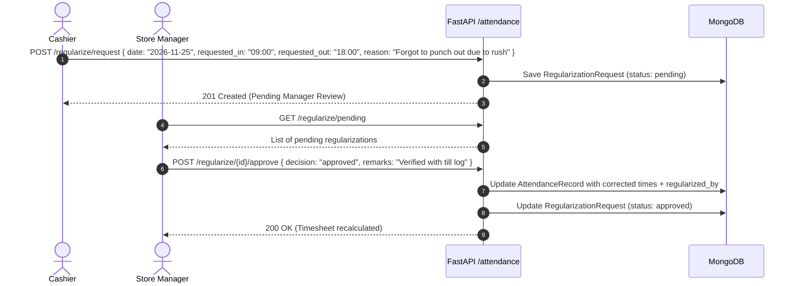
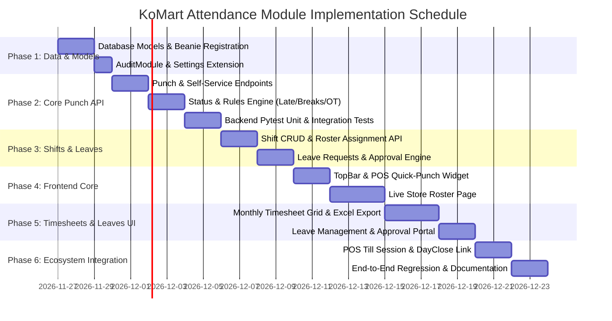

# KoMart Attendance & Workforce Management Module — Master Implementation Plan

**Document Version:** 1.0  
**Target Module:** Staff Attendance, Shift Scheduling, Leave Management & Workforce Analytics  
**Platform Stack:** FastAPI + Beanie (MongoDB) Backend, React 19 + MUI + Vite Frontend  
**Status:** Approved for Implementation  
**Location:** `docs/ATTENDANCE_PLAN.md`  
**Companion Document:** [DAILY_CHECKLIST_PLAN.md](./DAILY_CHECKLIST_PLAN.md) (Daily Operational Activities & Task Delegation)  

---

## 1. Executive Summary & Business Objectives

### 1.1 Supermarket Operational Context
In retail supermarket operations such as KoMart, labor accounts for a significant portion of operating expenditure. Frontline supermarket operations rely heavily on punctual shifts across cashiers, stockers, inventory managers, and floor supervisors. Currently, KoMart manages users and POS transactions efficiently, but lacks an integrated workforce attendance system:
1. **Paper or Unverified Punching**: Manual register sheets lead to unrecorded tardiness, phantom overtime, and unaccounted absences.
2. **Cashier Till vs. Physical Presence Disconnect**: Day closes (`DayClose`) and staff cash custody (`CashCustody`) record cash reconciliations, but cannot verify whether the assigned cashier arrived on time, took extended breaks, or clocked out before the register was counted.
3. **Break Leaks**: Supermarket rush hours (lunchtime and evening peaks) require full register staffing. Unscheduled or prolonged tea and meal breaks during peak hours degrade customer checkout speed.
4. **Payroll Preparation Friction**: Month-end salary preparation requires tedious manual reconciliation of working days, late penalty deductions, approved leaves, and overtime hours.

### 1.2 Core Objectives
- **Frictionless Punching**: Provide a 1-click **Clock In / Break / Clock Out** widget accessible from the persistent TopBar and POS screen for cashiers and store staff.
- **Live Floor Roster**: Give store managers a real-time visual board showing who is currently on the floor, who is on break, who is late, and who is absent today.
- **Shift Scheduling & Rules Engine**: Support flexible and scheduled shifts (e.g., Morning, Day, Evening, Night) with automated evaluation of **Late Arrival**, **Half-Day**, **Early Exit**, and **Overtime**.
- **Leave & Regularization Workflow**: Self-service leave requests with manager approval, plus audit-backed attendance regularization for missed punches.
- **Supermarket Ecosystem Integration**: Tie attendance directly into `User` profiles, `DayClose` till shifts, and `AuditLog` trails, with exportable timesheet reports ready for payroll.
- **Daily Operational Checklist Handshake**: Surface shift opening checklists upon Clock In and prompt staff regarding incomplete closing duties before Clock Out (see [DAILY_CHECKLIST_PLAN.md](./DAILY_CHECKLIST_PLAN.md)).

---

## 2. Target Personas & Use Cases

| Persona | Primary Needs & Actions |
| :--- | :--- |
| **Cashier / Floor Staff** | • 1-click Clock In upon arrival at the store.<br>• Log Tea / Lunch breaks during shift.<br>• Clock Out at end of shift after till handover.<br>• View personal monthly attendance calendar and hours worked.<br>• Submit leave requests and missed-punch regularization requests. |
| **Store Manager** | • Real-time "Live Roster" view of store floor attendance.<br>• Review and approve/reject leave requests and punch adjustments.<br>• Assign weekly shifts to cashiers and staff.<br>• Monitor late arrivals during morning store opening.<br>• Ensure all registers have clocked-in operators before peak hours. |
| **Store Owner / Admin** | • Configure store shifts, grace periods (e.g., 15 mins), and overtime thresholds.<br>• Restrict clock-ins to store network (Store IP / Wi-Fi whitelist).<br>• Generate and export monthly staff timesheet reports for payroll.<br>• Full immutable audit history of all attendance adjustments. |

---

## 3. High-Level Architecture & Information Lineage



---

## 4. Workflows & Sequence Diagrams

### 4.1 Staff Punch Lifecycle (Clock In, Breaks, Clock Out)



### 4.2 Missed Punch Regularization Flow



---

## 5. Data Architecture & Database Models

### 5.1 MongoDB Collections

The feature introduces three core Beanie document collections and extends existing settings and audit logs:

#### 1. `AttendanceRecord` (collection: `attendance_records`)
Stores daily attendance records per employee.

```python
class AttendanceStatus(str, Enum):
    present = "present"
    late = "late"
    half_day = "half_day"
    absent = "absent"
    on_leave = "on_leave"
    holiday = "holiday"
    day_off = "day_off"


class PunchSource(str, Enum):
    pos_terminal = "pos_terminal"
    web_portal = "web_portal"
    mobile_web = "mobile_web"
    manager_manual = "manager_manual"
    auto_system = "auto_system"


class BreakType(str, Enum):
    lunch = "lunch"
    tea = "tea"
    personal = "personal"


class BreakItem(BaseModel):
    break_type: BreakType = BreakType.tea
    start_time: datetime
    end_time: Optional[datetime] = None
    duration_minutes: int = 0
    notes: Optional[str] = None


class AttendanceRecord(Document):
    user_id: Indexed(str)
    user_name: str
    user_role: str  # cashier, manager, admin, staff
    date: Indexed(str)  # YYYY-MM-DD
    
    # Shift Reference
    shift_id: Optional[str] = None
    shift_name: Optional[str] = None
    scheduled_start: Optional[str] = None  # HH:MM
    scheduled_end: Optional[str] = None    # HH:MM

    # Punch Timestamps (UTC)
    clock_in: Optional[datetime] = None
    clock_out: Optional[datetime] = None

    # Breaks
    breaks: List[BreakItem] = Field(default_factory=list)
    is_on_break: bool = False
    current_break_type: Optional[BreakType] = None

    # Calculated Durations (Minutes)
    total_work_minutes: int = 0
    total_break_minutes: int = 0
    effective_work_minutes: int = 0  # total_work_minutes - total_break_minutes
    overtime_minutes: int = 0
    late_minutes: int = 0
    early_exit_minutes: int = 0

    # Status
    status: AttendanceStatus = AttendanceStatus.absent
    source: PunchSource = PunchSource.web_portal
    
    # Context & Network Info
    ip_address: Optional[str] = None
    device_info: Optional[str] = None
    notes: Optional[str] = None

    # Regularization / Manual Adjustments
    is_regularized: bool = False
    regularization_reason: Optional[str] = None
    regularized_by: Optional[str] = None
    regularized_at: Optional[datetime] = None

    created_at: datetime = Field(default_factory=lambda: datetime.now(timezone.utc))
    updated_at: datetime = Field(default_factory=lambda: datetime.now(timezone.utc))

    class Settings:
        name = "attendance_records"
        indexes = [
            IndexModel([("user_id", ASCENDING), ("date", ASCENDING)], unique=True),
            IndexModel([("date", ASCENDING), ("status", ASCENDING)]),
            IndexModel([("date", ASCENDING), ("is_on_break", ASCENDING)]),
            IndexModel([("user_id", ASCENDING), ("status", ASCENDING)]),
        ]
```

#### 2. `Shift` (collection: `shifts`)
Configurable working shifts for retail operations.

```python
class Shift(Document):
    name: str  # e.g., "Morning Cashier Shift", "Evening Shift"
    code: Indexed(str, unique=True)  # e.g., "MORN", "EVE", "FULL"
    start_time: str  # "08:00" (24-hr format)
    end_time: str    # "16:00"
    
    # Thresholds & Rules
    grace_period_minutes: int = 15     # Clocking in up to 08:15 is still considered on time
    half_day_threshold_minutes: int = 240 # Minimum 4 hrs for half-day
    full_day_threshold_minutes: int = 420 # Minimum 7 hrs for full-day
    break_allowance_minutes: int = 60     # Paid/allowed break time
    
    color_code: str = "#2563EB"  # For calendar/roster visual UI
    is_active: bool = True
    days_of_week: List[int] = Field(default_factory=lambda: [0, 1, 2, 3, 4, 5, 6])  # 0=Mon, 6=Sun

    created_at: datetime = Field(default_factory=lambda: datetime.now(timezone.utc))
    updated_at: datetime = Field(default_factory=lambda: datetime.now(timezone.utc))

    class Settings:
        name = "shifts"
```

#### 3. `ShiftAssignment` (collection: `shift_assignments`)
Maps employees to specific shifts or recurring weekly rosters.

```python
class ShiftAssignment(Document):
    user_id: Indexed(str)
    user_name: str
    shift_id: str
    shift_name: str
    effective_from: str  # YYYY-MM-DD
    effective_to: Optional[str] = None  # None = indefinite
    assigned_by: str
    created_at: datetime = Field(default_factory=lambda: datetime.now(timezone.utc))

    class Settings:
        name = "shift_assignments"
        indexes = [
            IndexModel([("user_id", ASCENDING), ("effective_from", DESCENDING)]),
        ]
```

#### 4. `LeaveRequest` (collection: `leave_requests`)
Employee leave applications and management approvals.

```python
class LeaveType(str, Enum):
    casual = "casual"
    sick = "sick"
    annual = "annual"
    unpaid = "unpaid"
    maternity_paternity = "maternity_paternity"


class LeaveStatus(str, Enum):
    pending = "pending"
    approved = "approved"
    rejected = "rejected"
    cancelled = "cancelled"


class LeaveRequest(Document):
    user_id: Indexed(str)
    user_name: str
    leave_type: LeaveType
    start_date: str  # YYYY-MM-DD
    end_date: str    # YYYY-MM-DD
    days_count: float = 1.0  # 0.5 for half day
    is_half_day: bool = False
    reason: str
    status: LeaveStatus = LeaveStatus.pending
    
    # Approval metadata
    reviewed_by: Optional[str] = None
    reviewed_by_name: Optional[str] = None
    reviewed_at: Optional[datetime] = None
    rejection_reason: Optional[str] = None

    created_at: datetime = Field(default_factory=lambda: datetime.now(timezone.utc))

    class Settings:
        name = "leave_requests"
        indexes = [
            IndexModel([("user_id", ASCENDING), ("status", ASCENDING)]),
            IndexModel([("start_date", ASCENDING), ("end_date", ASCENDING)]),
        ]
```

#### 5. Integration with Existing Models:
- **`StoreSettings` (`app/models/settings.py`)**: Add an embedded `AttendanceConfig`:
  - `attendance_enabled: bool = True`
  - `enforce_store_ip: bool = False`
  - `allowed_ips: List[str] = []`
  - `default_shift_id: Optional[str] = None`
  - `require_clock_in_for_pos: bool = False` (soft alert or hard block when opening POS till)
  - `auto_clock_out_hours: int = 14` (safety auto-clockout if staff forgets)
- **`AuditLog` (`app/models/audit_log.py`)**: Add `AuditModule.attendance = "attendance"` to log punch edits, manual overrides, and leave approvals.

---

## 6. Business Logic & Rules Engine

### 6.1 Status Evaluation Logic
When an employee clocks in or the end-of-day attendance reconciler runs, the system calculates their status using the following deterministic rules:

```
Scheduled Shift: 09:00 - 18:00 (Grace period: 15 mins)
Clock-in time: T_in
Clock-out time: T_out

1. IF LeaveRequest approved for today:
   -> Status = 'on_leave'

2. IF No Clock-in recorded by end of scheduled shift:
   -> Status = 'absent'

3. IF T_in <= Shift.start_time + Shift.grace_period_minutes:
   -> Status = 'present', late_minutes = 0
   ELSE:
   -> Status = 'late', late_minutes = (T_in - Shift.start_time) in minutes

4. IF T_out recorded:
   Total Working Minutes = (T_out - T_in) - Total Break Minutes
   IF Total Working Minutes < Shift.half_day_threshold_minutes:
       -> Status = 'half_day'
   IF Total Working Minutes > (Shift.end_time - Shift.start_time):
       -> Overtime Minutes = Total Working Minutes - Scheduled Duration
```

### 6.2 Break Rules
1. **Concurrency**: An employee cannot start a new break while already on an active break.
2. **Break Types**:
   - `Tea Break`: Recommended limit 15 minutes.
   - `Lunch Break`: Recommended limit 45 minutes.
3. **Automatic Deductions**: Break durations are subtracted from gross clock time to derive `effective_work_minutes`.

### 6.3 End-of-Day Auto-Reconciliation (Midnight Task)
Staff occasionally forget to clock out before going home.
- A nightly background job executes at 23:59:
  - Finds any `attendance_records` for today where `clock_in` is present but `clock_out` is `None`.
  - Sets `clock_out` to scheduled shift end time (or tags `auto_system`), clamps duration, and flags `is_regularized = False` with a notification to the Store Manager to verify the actual departure time.

---

## 7. REST API Specifications

Base URL: `/api/v1`

### 7.1 Punch & Staff Self-Service Endpoints

| Method | Path | Required Role | Description |
| :--- | :--- | :--- | :--- |
| `POST` | `/attendance/punch` | `cashier+` | Clock In, Start Break, End Break, or Clock Out. |
| `GET` | `/attendance/today` | `cashier+` | Get current user's live attendance state today. |
| `GET` | `/attendance/my-history` | `cashier+` | Monthly timesheet history for the logged-in user. |
| `POST` | `/attendance/regularize` | `cashier+` | Request manual punch correction for missed punch. |

#### Punch Request Payload:
```json
{
  "action": "clock_in", // "clock_in" | "break_start" | "break_end" | "clock_out"
  "break_type": "tea",  // required if action == "break_start"
  "notes": "Arrived on store opening shift"
}
```

#### Punch Response:
```json
{
  "id": "6745...",
  "user_id": "6710...",
  "user_name": "Suman Sharma",
  "date": "2026-11-26",
  "status": "present",
  "clock_in": "2026-11-26T03:15:00Z",
  "clock_out": null,
  "is_on_break": false,
  "current_break_type": null,
  "total_work_minutes": 185,
  "total_break_minutes": 15,
  "effective_work_minutes": 170,
  "shift_name": "Morning Cashier Shift"
}
```

### 7.2 Manager & Admin Management Endpoints

| Method | Path | Required Role | Description |
| :--- | :--- | :--- | :--- |
| `GET` | `/attendance/live-roster` | `manager+` | Real-time floor status: active, on break, late, absent. |
| `GET` | `/attendance/records` | `manager+` | Filtered list of attendance records with pagination. |
| `GET` | `/attendance/summary` | `manager+` | KPI summary cards (Present, Late, Absent, On Leave, Overtime). |
| `PATCH` | `/attendance/records/{id}` | `manager+` | Manager manual edit/regularization of an attendance record. |
| `GET` | `/attendance/export` | `manager+` | Download Excel / CSV timesheet for payroll. |

### 7.3 Shifts & Roster Endpoints

| Method | Path | Required Role | Description |
| :--- | :--- | :--- | :--- |
| `GET` | `/shifts` | `cashier+` | List active store shifts. |
| `POST` | `/shifts` | `admin` | Create a new shift definition. |
| `PATCH` | `/shifts/{id}` | `admin` | Update shift hours or grace period. |
| `GET` | `/shifts/assignments` | `manager+` | View current staff shift assignments. |
| `POST` | `/shifts/assignments` | `manager+` | Assign an employee to a shift roster. |

### 7.4 Leave Management Endpoints

| Method | Path | Required Role | Description |
| :--- | :--- | :--- | :--- |
| `POST` | `/leaves` | `cashier+` | Submit a leave request. |
| `GET` | `/leaves` | `cashier+` | List leaves (cashier sees own; manager sees all). |
| `PATCH` | `/leaves/{id}/review` | `manager+` | Approve or reject a leave request. |
| `DELETE` | `/leaves/{id}` | `cashier+` | Cancel a pending leave request. |

---

## 8. Frontend UX & Component Architecture

### 8.1 Persistent Quick-Punch Widget (TopBar & POS)
- Located on the right side of the existing `TopBar` and POS header.
- Displays current status chip with live timer:
  - **Not Clocked In**: Yellow chip `[ Clock In ]` button.
  - **Clocked In / Working**: Green pulsating chip `● 04h 22m` with drop-down for `[ Start Break ]` and `[ Clock Out ]`.
  - **On Break**: Orange chip `☕ On Lunch (18m)` with prominent `[ Resume Work ]` button.
- Clicking opens a compact, responsive dialog with punch details, notes, and today's shift timings.

### 8.2 Navigation & Routing
Add `/attendance` to `NAV_ITEMS` in `src/constants/index.ts`:
- **Label**: `Attendance`
- **Icon**: `AccessTime` or `PunchClock`
- **Roles**: `['admin', 'manager', 'cashier']`
- **Route Sub-views**:
  - `/attendance` (Default: Cashier sees Personal Timesheet; Manager sees Live Roster)
  - `/attendance/roster` (Manager: Live floor muster roll)
  - `/attendance/timesheets` (Manager: Store-wide monthly timesheet matrix)
  - `/attendance/leaves` (Staff & Manager: Leave applications & approvals)
  - `/attendance/shifts` (Admin/Manager: Shift setup and roster assignment)

### 8.3 Core UI Screens

#### Screen 1: Live Store Roster (`LiveRosterPage.tsx`)
- **Real-Time KPI Strip**:
  - `Present Today` (e.g. 14 / 16 staff)
  - `On Floor Right Now` (11 active)
  - `On Break` (3 in tea/lunch)
  - `Late Arrivals` (2 flagged)
  - `On Leave` (2 approved)
- **Visual Roster Cards & Table**:
  - Avatar, Staff Name, Role (Cashier, Supervisor, Stocker).
  - Assigned Shift (e.g. 08:00 - 16:00).
  - Clock-In Time + Tardiness Badge (e.g., `+18m Late` in warning orange).
  - Current Status Chip (Present, On Break, Completed).
  - Quick Action button: `[ Regularize / Edit ]`.

#### Screen 2: Monthly Timesheet Matrix (`TimesheetMatrixPage.tsx`)
- Grid view modeled after KoMart's Excel-like density.
- Rows = Staff Members; Columns = Days of the Month (1 to 31).
- Cells display concise status codes:
  - `P` (Green = Present)
  - `L` (Orange = Late arrival)
  - `HD` (Yellow = Half day)
  - `A` (Red = Absent)
  - `LV` (Blue = Approved Leave)
  - `OFF` (Grey = Scheduled Day Off)
- Hovering shows exact punch times and total hours; clicking opens the day's breakdown modal.
- One-click **Export to Excel** button generating an accounting-ready timesheet.

#### Screen 3: Leave Management (`LeaveManagementPage.tsx`)
- **Leave Balance Summary Cards**: Casual, Sick, Annual balances.
- **Request Leave Modal**: Date picker, half-day toggle, reason text box.
- **Manager Approval Table**: Pending applications with `[ Approve ]` and `[ Reject ]` buttons and reason popover.

---

## 9. Security, Geofencing & Fraud Prevention

1. **Buddy Punching Prevention**:
   - Punch requests record the client IP address and browser/device fingerprint.
   - Optional Store Wi-Fi Geofence: If `enforce_store_ip` is enabled in `StoreSettings`, requests from external IPs or mobile carrier data are rejected with HTTP 403 (`"Punches must be made from store Wi-Fi network"`).
   - Cashiers on the POS terminal can punch directly through the authenticated register session.
2. **Audit Trails & Tamper Resistance**:
   - Punch timestamps are server-generated (`datetime.now(timezone.utc)`) — never trust client device time.
   - Every manual change or regularization is recorded in `AuditLog` under `AuditModule.attendance` with `previous_value`, `new_value`, manager ID, and timestamp.
3. **Role-Based Access Control (RBAC)**:
   - `cashier`: Can only punch for self, view own history, and submit own leave requests.
   - `manager`: Can view all store staff, approve leaves, assign shifts, and regularize punches.
   - `admin`: Full control including shift creation, network policy configuration, and audit review.

---

## 10. Phased Implementation Roadmap



### Detailed Phase Tasks

#### Phase 1: Foundation & Persistence
- [x] Create `backend/app/models/attendance.py` with `AttendanceRecord`, `Shift`, `ShiftAssignment`, `LeaveRequest`.
- [x] Register new models in `backend/app/database.py` and `backend/app/models/__init__.py`.
- [x] Add `AuditModule.attendance` to `backend/app/models/audit_log.py`.
- [x] Extend `StoreSettings` in `backend/app/models/settings.py` with `AttendanceConfig`.
- [x] Create database migration/index creation helper for `attendance_records` and `shifts`.

#### Phase 2: Core Punch API & Rules Engine
- [x] Implement `backend/app/schemas/attendance.py` with Pydantic request/response schemas.
- [x] Implement calculation service `backend/app/services/attendance_engine.py` (late arrival calculation, break duration tallying, overtime calculation).
- [x] Implement router `backend/app/routers/attendance.py` (`POST /punch`, `GET /today`, `GET /my-history`).
- [x] Write automated pytest suite in `backend/tests/test_attendance_punch.py`.

#### Phase 3: Shifts, Rostering & Leave Management
- [x] Implement `backend/app/routers/shifts.py` (CRUD for shifts and shift assignments).
- [x] Implement `backend/app/routers/leaves.py` (Leave application, manager approval/rejection, cancellation).
- [x] Implement regularization endpoint (`POST /attendance/regularize` and manager approval).
- [x] Write automated tests in `backend/tests/test_shifts_and_leaves.py`.

#### Phase 4: Frontend Quick-Punch & Live Roster
- [x] Add `Attendance` to `frontend/src/constants/index.ts` (`NAV_ITEMS`) and update `Sidebar.tsx`.
- [x] Build `TopBarAttendanceWidget.tsx` and integrate into `TopBar.tsx` and POS header.
- [x] Create API service `frontend/src/services/attendanceService.ts`.
- [x] Build `LiveRosterPage.tsx` with live KPI tiles, status chips, and floor presence cards.

#### Phase 5: Monthly Timesheets, Regularization & Leaves UI
- [x] Build `TimesheetMatrixPage.tsx` with monthly calendar grid, status filters, and export button.
- [x] Build `LeaveManagementPage.tsx` with leave balances, application dialog, and manager approval queue.
- [x] Build `ShiftPlannerPage.tsx` for weekly shift assignments.
- [x] Build `RegularizePunchModal.tsx` for staff requests and manager edits.

#### Phase 6: POS Integration, Reports & Sign-off
- [x] Connect POS till opening to verify cashier attendance status (friendly warning if cashier hasn't clocked in).
- [x] Add Attendance KPI summary card to Executive Dashboard (`/reports?tab=executive`).
- [x] Comprehensive E2E manual QA test run across Cashier, Manager, and Admin roles.
- [x] Update `docs/Memory.md` and release documentation.

---

## 11. Testing & Acceptance Criteria

### 11.1 Automated Test Suite Matrix
- `test_clock_in_on_time`: Staff clocking in within grace period receives `present` status and `late_minutes = 0`.
- `test_clock_in_late`: Staff clocking in past grace period receives `late` status with accurate `late_minutes`.
- `test_break_lifecycle`: Start break sets `is_on_break = True`; end break calculates exact duration and restores `is_on_break = False`.
- `test_overlapping_punches`: Duplicate clock-in attempts on the same day are rejected with HTTP 400.
- `test_leave_approval_updates_attendance`: Approving a leave creates or marks that day's attendance as `on_leave`.
- `test_regularization_audit`: Manager manual override updates work minutes and creates an `AuditLog` entry.
- `test_role_permissions`: Cashier cannot access `/attendance/records` or approve leaves (HTTP 403).

### 11.2 Acceptance Criteria Checklist
1. **Cashier Experience**: Cashier can clock in and out from the TopBar or POS screen with zero page reloads.
2. **Manager Real-Time Visibility**: Store Manager can view the floor roster and see live attendance status updated within 30 seconds.
3. **Calculation Accuracy**: Late minutes, break durations, and overtime are mathematically precise and round to the nearest minute.
4. **Data Integrity**: An employee cannot have duplicate attendance records for the same calendar day.
5. **Timesheet Export**: Manager can download a complete monthly timesheet Excel/CSV matching all KoMart retail criteria.
