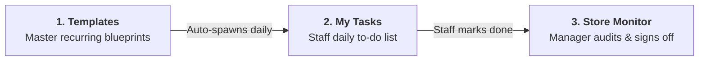
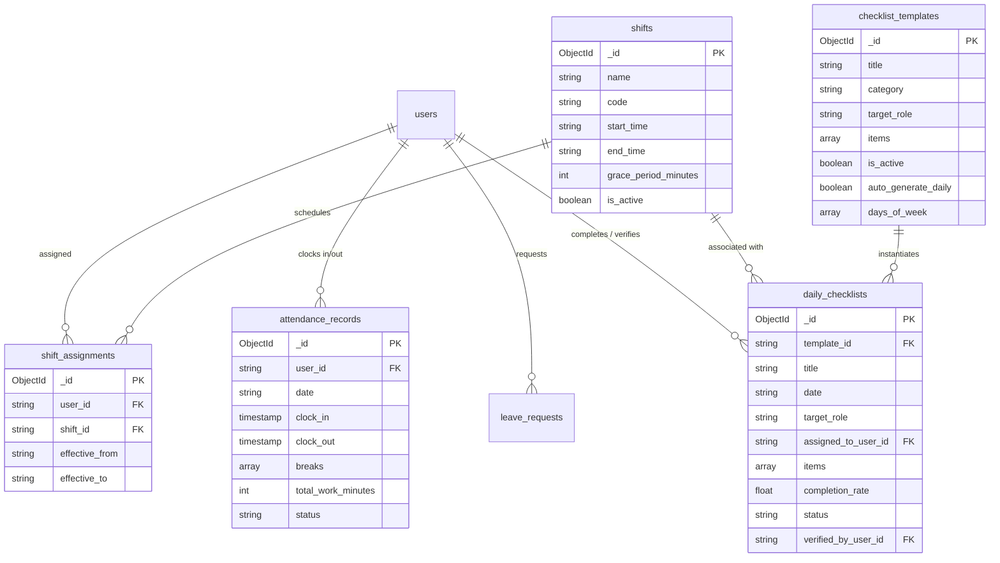
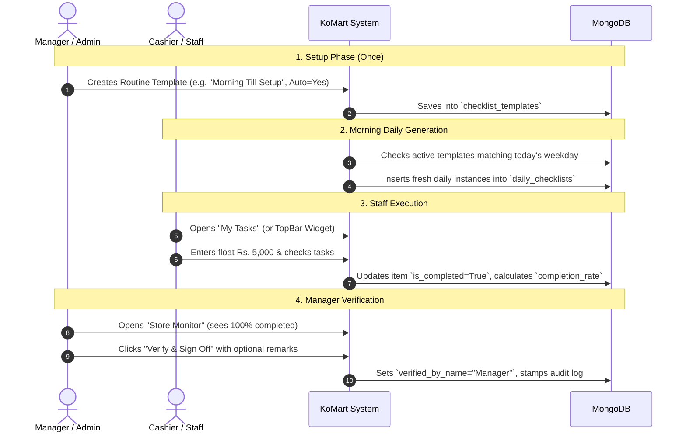

# KoMart Daily Checklists & Workforce Operations Guide

**Platform:** KoMart Retail Management System  
**Backend:** FastAPI + Beanie (MongoDB)  
**Frontend:** React 19 + TypeScript + Vite + Material UI (MUI)  
**Date:** November 2026  

---

## 1. Overview & Core Philosophy

In a retail supermarket like KoMart, daily operations, stock hygiene, cash accuracy, and shrinkage control depend on consistent routines. 

The **Checklists & Workforce** module simplifies store operations into **three straightforward concepts**:

1. **My Tasks (Today's Tasks)**:
   * **Who uses it?** Cashiers, floor staff, stockers, and duty managers.
   * **What does it do?** A fast, clean daily to-do list showing only the tasks assigned to the logged-in staff member or their role for today. Staff tap checkboxes to mark tasks complete, optionally entering numeric values (like opening float Rs. 5,000 or fridge temperature 4°C).
2. **Store Monitor (Operations Control Room)**:
   * **Who uses it?** Store Managers and Owners/Admins.
   * **What does it do?** A real-time control room showing all store checklists across all registers and departments. Managers can monitor completion rates, review recorded values, audit past dates, and click **"Verify & Sign Off"** to digitally stamp completed checklists.
3. **Routine Templates (Master Blueprints)**:
   * **Who uses it?** Managers and Admins.
   * **What does it do?** Standard operating procedure (SOP) blueprints (e.g. *Cashier Morning Till Setup*, *Perishables Temperature Log*, *Closing Safe & Shutter Lock*). Templates automatically instantiate daily checklists every morning based on active days of the week.

---

## 2. Database Architecture (Collections & Tables)

KoMart uses **MongoDB** managed via **Beanie ODM** (Python Pydantic + Motor). Below are all collections directly powering Checklists, Shifts, and Staff Attendance.

---

### Collection 1: `checklist_templates`
* **Python Model:** `ChecklistTemplate` ([checklist.py](file:///g:/Vibe%20Coding/KoMart/backend/app/models/checklist.py#L35))
* **Purpose:** Stores recurring checklist blueprints that define daily store standard operating procedures (SOPs).

| Field Name | Type | Description |
| :--- | :--- | :--- |
| `_id` | `ObjectId` | Primary Key. |
| `title` | `String` | Routine title (e.g., *"Cashier Morning Register Checklist"*). |
| `description` | `String (Optional)` | Detailed instructions or guidelines for staff. |
| `category` | `Enum` | `opening`, `mid_day`, `closing`, `hygiene_safety`, `inventory`, `general`. |
| `target_role` | `Enum` | `cashier`, `manager`, `all`. |
| `shift_id` | `String (Optional)` | Link to specific shift (e.g., morning shift only). |
| `shift_name` | `String (Optional)` | Denormalized shift name for fast reads. |
| `items` | `Array[TemplateItem]` | List of task definitions (see sub-schema below). |
| `is_active` | `Boolean` | Default `True`. Soft deactivation flag. |
| `auto_generate_daily`| `Boolean` | Default `True`. When enabled, auto-generates daily instances. |
| `days_of_week` | `Array[Integer]` | `[0, 1, 2, 3, 4, 5, 6]` where 0=Monday, 6=Sunday. |
| `created_by` | `String` | User ID of the creator. |
| `created_by_name` | `String` | Creator's full name. |
| `created_at` / `updated_at` | `DateTime (UTC)` | Timestamps. |

**Embedded Sub-Schema: `TemplateItem`**
* `id` (`String`): Unique item ID (e.g., `"item-01"`).
* `title` (`String`): Action text (e.g., *"Count opening cash float"*).
* `description` (`String`): Helper notes.
* `is_mandatory` (`Boolean`): Requires completion before shift end/clock-out.
* `order` (`Integer`): Display sequence (1, 2, 3...).
* `requires_numeric_input` (`Boolean`): True if staff must input a number.
* `numeric_unit` (`String`): Unit label, e.g., `"NPR"`, `"°C"`, `"Units"`.
* `requires_note` (`Boolean`): True if remarks are mandatory.

**Indexes:**
* `(target_role: 1, is_active: 1)`
* `(category: 1)`
* `(is_active: 1)`

---

### Collection 2: `daily_checklists`
* **Python Model:** `DailyChecklist` ([checklist.py](file:///g:/Vibe%20Coding/KoMart/backend/app/models/checklist.py#L92))
* **Purpose:** Daily active instances of checklists. Generated automatically each morning or created ad-hoc for a specific date.

| Field Name | Type | Description |
| :--- | :--- | :--- |
| `_id` | `ObjectId` | Primary Key. |
| `template_id` | `String (Optional)` | Reference to origin template (null if ad-hoc). |
| `title` | `String` | Checklist name. |
| `description` | `String (Optional)` | Description. |
| `category` | `Enum` | `opening`, `mid_day`, `closing`, `hygiene_safety`, `inventory`, `general`. |
| `date` | `String (YYYY-MM-DD)` | The calendar date of execution in Nepal Time (UTC+05:45). |
| `target_role` | `Enum` | Role eligible to complete the checklist (`cashier`, `manager`, `all`). |
| `assigned_to_user_id`| `String (Optional)` | If assigned to a specific person; `null` if broadcast to all staff with `target_role`. |
| `assigned_to_user_name`| `String (Optional)` | Assignee name. |
| `assigned_by_user_id`| `String` | User who assigned or generated the checklist. |
| `assigned_by_user_name`| `String` | Assigning user name. |
| `shift_id` / `shift_name` | `String (Optional)` | Shift reference if tied to a specific roster shift. |
| `items` | `Array[DailyChecklistItem]` | Active items with execution states (see sub-schema below). |
| `total_items_count` | `Integer` | Total items in checklist. |
| `completed_items_count`| `Integer` | Count of finished items. |
| `completion_rate` | `Float` | Completion percentage (`0.0` to `100.0%`). |
| `status` | `Enum` | `pending`, `in_progress`, `completed`, `overdue`. |
| `requires_manager_verification` | `Boolean` | True if a manager sign-off is needed. |
| `verified_by_user_id`| `String (Optional)` | Manager who inspected and signed off. |
| `verified_by_name` | `String (Optional)` | Manager's name. |
| `verified_at` | `DateTime (UTC)` | Timestamp of digital sign-off. |
| `manager_remarks` | `String (Optional)` | Inspection findings or audit remarks. |
| `completed_at` | `DateTime (UTC)` | Timestamp when all items reached 100%. |

**Embedded Sub-Schema: `DailyChecklistItem`**
* `id` (`String`): Item identifier.
* `title` (`String`): Task title.
* `description` (`String`): Additional details.
* `is_mandatory` (`Boolean`): Mandatory flag.
* `order` (`Integer`): Sort index.
* `is_completed` (`Boolean`): `True` if checked off.
* `completed_by_user_id` (`String`): ID of user who completed the item.
* `completed_by_name` (`String`): Name of user who completed the item.
* `completed_at` (`DateTime (UTC)`): When item was checked.
* `numeric_input` (`Float`): Recorded numeric value (e.g., `4.5` for temperature, `5000` for cash float).
* `numeric_unit` (`String`): `"°C"`, `"NPR"`, etc.
* `notes` (`String`): Optional item remarks.

**Indexes:**
* `(date: 1, target_role: 1)`
* `(date: 1, assigned_to_user_id: 1)`
* `(date: 1, status: 1)`
* `(date: -1)`

---

### Collection 3: `shifts`
* **Python Model:** `Shift` ([attendance.py](file:///g:/Vibe%20Coding/KoMart/backend/app/models/attendance.py#L99))
* **Purpose:** Master store shift definitions (e.g. Morning, Evening, General).

| Field Name | Type | Description |
| :--- | :--- | :--- |
| `_id` | `ObjectId` | Primary Key. |
| `name` | `String` | Shift label (e.g., *"Morning Shift"*). |
| `code` | `String (Unique)` | Short code (e.g., `"MORN"`, `"EVE"`, `"GEN"`). |
| `start_time` | `String (HH:MM)` | Scheduled start time in 24-hr format (e.g., `"08:00"`). |
| `end_time` | `String (HH:MM)` | Scheduled end time (e.g., `"16:00"`). |
| `grace_period_minutes` | `Integer` | Grace threshold (default `15` min). Clocking in within grace is on-time. |
| `half_day_threshold_minutes` | `Integer` | Minimum worked minutes for half-day credit (default `240` min / 4 hrs). |
| `full_day_threshold_minutes` | `Integer` | Minimum worked minutes for full-day credit (default `420` min / 7 hrs). |
| `break_allowance_minutes` | `Integer` | Paid/allowed break time (default `60` min). |
| `color_code` | `String` | Hex color code for calendar/roster visual UI (e.g., `"#2563EB"`). |
| `days_of_week` | `Array[Integer]` | Applicable days `[0..6]`. |
| `is_active` | `Boolean` | Active flag. |

---

### Collection 4: `shift_assignments`
* **Python Model:** `ShiftAssignment` ([attendance.py](file:///g:/Vibe%20Coding/KoMart/backend/app/models/attendance.py#L126))
* **Purpose:** Links individual employees to a specific shift schedule.

| Field Name | Type | Description |
| :--- | :--- | :--- |
| `_id` | `ObjectId` | Primary Key. |
| `user_id` | `String` | Employee ID. |
| `user_name` | `String` | Employee name. |
| `shift_id` | `String` | Shift foreign key. |
| `shift_name` | `String` | Shift label. |
| `effective_from` | `String (YYYY-MM-DD)` | Starting date of assignment. |
| `effective_to` | `String (Optional)` | Ending date; `null` indicates an ongoing assignment. |
| `assigned_by` | `String` | Manager user ID. |

---

### Collection 5: `attendance_records`
* **Python Model:** `AttendanceRecord` ([attendance.py](file:///g:/Vibe%20Coding/KoMart/backend/app/models/attendance.py#L41))
* **Purpose:** Daily staff punch logs, work durations, and break history.

| Field Name | Type | Description |
| :--- | :--- | :--- |
| `_id` | `ObjectId` | Primary Key. |
| `user_id` | `String` | Employee ID. |
| `user_name` | `String` | Employee name. |
| `user_role` | `String` | Role (`cashier`, `manager`, `admin`, `staff`). |
| `date` | `String (YYYY-MM-DD)` | Calendar date in Nepal Standard Time (UTC+05:45). |
| `shift_id` / `shift_name` | `String (Optional)` | Assigned shift at time of punch. |
| `clock_in` | `DateTime (UTC)` | Exact clock-in punch timestamp. |
| `clock_out` | `DateTime (UTC)` | Exact clock-out punch timestamp. |
| `breaks` | `Array[BreakItem]` | Break records (`break_type`, `start_time`, `end_time`, `duration_minutes`). |
| `is_on_break` | `Boolean` | True if currently on break. |
| `total_work_minutes` | `Integer` | Gross span between clock in and out. |
| `effective_work_minutes` | `Integer` | Net working time (`total_work_minutes - break_minutes`). |
| `late_minutes` | `Integer` | Minutes past scheduled shift start + grace period. |
| `overtime_minutes` | `Integer` | Minutes worked beyond shift end. |
| `status` | `Enum` | `present`, `late`, `half_day`, `absent`, `on_leave`, `holiday`, `day_off`. |
| `source` | `Enum` | `pos_terminal`, `web_portal`, `mobile_web`, `manager_manual`. |

---

### Collection 6: `leave_requests`
* **Python Model:** `LeaveRequest` ([attendance.py](file:///g:/Vibe%20Coding/KoMart/backend/app/models/attendance.py#L158))
* **Purpose:** Tracks staff vacation, sick, or casual leave requests and manager approvals.

| Field Name | Type | Description |
| :--- | :--- | :--- |
| `_id` | `ObjectId` | Primary Key. |
| `user_id` | `String` | Requester ID. |
| `user_name` | `String` | Employee name. |
| `leave_type` | `Enum` | `casual`, `sick`, `annual`, `unpaid`, `maternity_paternity`. |
| `start_date` / `end_date` | `String (YYYY-MM-DD)` | Date range. |
| `days_count` | `Float` | Total days (e.g., `1.0` or `0.5` for half-day). |
| `reason` | `String` | Reason provided by employee. |
| `status` | `Enum` | `pending`, `approved`, `rejected`, `cancelled`. |
| `reviewed_by` / `reviewed_by_name` | `String (Optional)` | Manager who approved/rejected. |
| `reviewed_at` | `DateTime (UTC)` | Review timestamp. |

---

### Collection 7: `store_settings`
* **Python Model:** `StoreSettings` ([settings.py](file:///g:/Vibe%20Coding/KoMart/backend/app/models/settings.py))
* **Purpose:** Holds system-wide operational toggles under `attendance_config` and `checklist_config`:
  * `attendance_config.attendance_enabled` (`Boolean`): Master switch for staff attendance. When `False`, clock-in locks are bypassed in POS.
  * `attendance_config.grace_period_minutes` (`Integer`): Global grace period.
  * `attendance_config.require_clock_in_for_pos` (`Boolean`): Requires cashiers to clock in before completing POS transactions.

---

## 3. Daily Operational Lifecycle & Workflows

---

## 4. REST API Endpoints Summary

### Checklists (`/api/v1/checklists`)
| Method | Endpoint | Access | Description |
| :--- | :--- | :--- | :--- |
| `GET` | `/checklists/my-today` | All Authenticated | Get current user's assigned checklist tasks for today. |
| `PATCH`| `/checklists/{id}/items/{item_id}` | All Authenticated | Mark a task item completed/uncompleted, record numeric value/notes. |
| `GET` | `/checklists/overview` | Manager, Admin | Get all store checklists for a specific date with progress and verification stats. |
| `POST`| `/checklists/{id}/verify` | Manager, Admin | Digitally sign off and verify a completed checklist. |
| `POST`| `/checklists/generate-daily` | Manager, Admin | Manually trigger generation of daily checklists from active templates. |
| `POST`| `/checklists/daily` | Manager, Admin | Create an immediate ad-hoc checklist for today. |
| `GET` | `/checklists/templates` | Manager, Admin | List all routine templates. |
| `POST`| `/checklists/templates` | Manager, Admin | Create a new routine template. |
| `PUT` | `/checklists/templates/{id}` | Manager, Admin | Update an existing template. |
| `DELETE`| `/checklists/templates/{id}` | Manager, Admin | Soft-deactivate a routine template. |

### Shifts & Roster (`/api/v1/shifts`)
| Method | Endpoint | Access | Description |
| :--- | :--- | :--- | :--- |
| `GET` | `/shifts` | All Authenticated | List all active shift definitions. |
| `POST`| `/shifts` | Manager, Admin | Create a new shift definition. |
| `PUT` | `/shifts/{id}` | Manager, Admin | Update shift definition. |
| `DELETE`| `/shifts/{id}` | Manager, Admin | Delete a shift definition and cascade delete its assignments. |
| `GET` | `/shifts/assignments` | Manager, Admin | List employee shift roster assignments. |
| `POST`| `/shifts/assignments` | Manager, Admin | Assign an employee to a shift. |
| `PATCH`| `/shifts/assignments/{id}` | Manager, Admin | Update an existing shift roster assignment. |
| `DELETE`| `/shifts/assignments/{id}`| Manager, Admin | Delete a shift roster assignment. |
