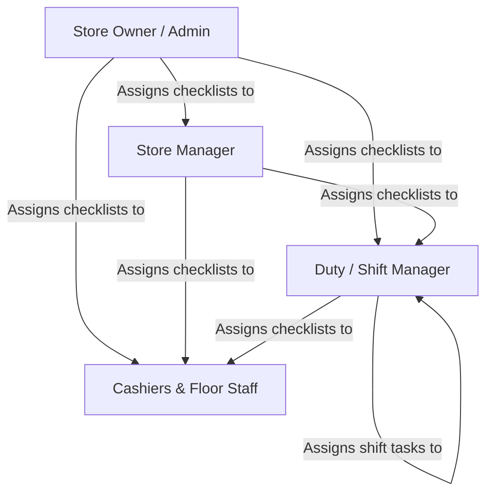
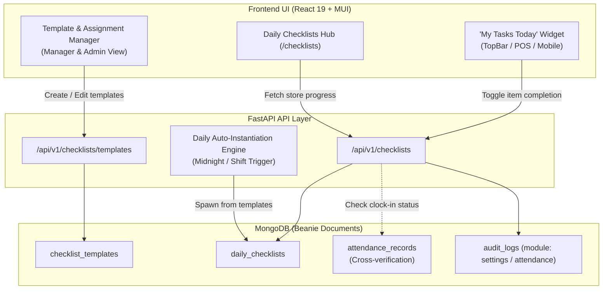
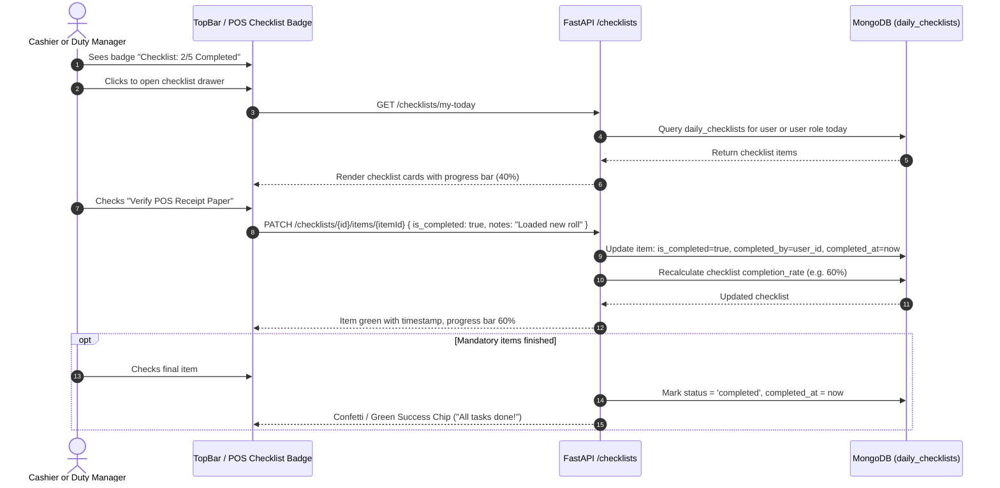
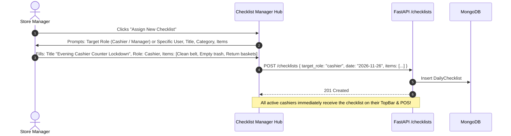
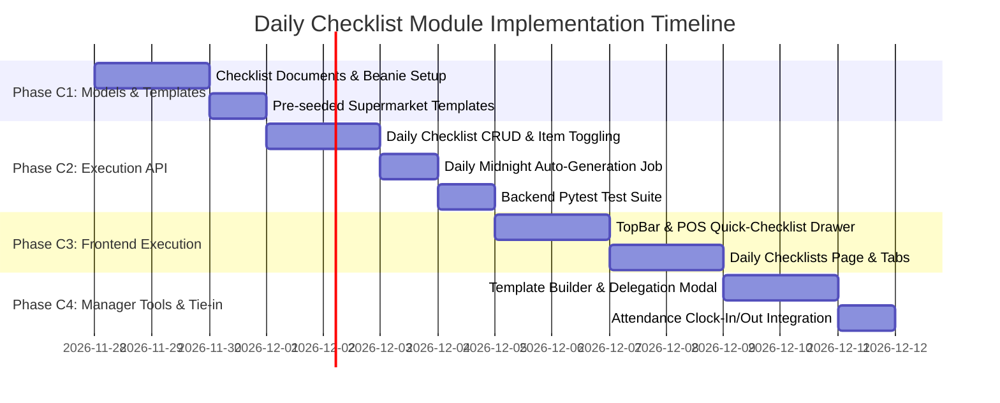

# KoMart Daily Operational Checklist Module — Master Implementation Plan

**Document Version:** 1.0  
**Target Module:** Daily Activities & Operational Checklist Management  
**Target Roles:** Cashiers, Floor Staff, Shift Managers, Store Managers, Admins  
**Platform Stack:** FastAPI + Beanie (MongoDB) Backend, React 19 + MUI + Vite Frontend  
**Status:** Approved for Implementation  
**Location:** `docs/DAILY_CHECKLIST_PLAN.md`  
**Companion Document:** [ATTENDANCE_PLAN.md](./ATTENDANCE_PLAN.md)  

---

## 1. Executive Summary & Business Objectives

### 1.1 Supermarket Daily Operational Problem
In a fast-paced retail supermarket like KoMart, store performance, customer satisfaction, hygiene, and shrinkage control rely on consistent daily routines. Currently:
1. **Unstructured Daily Handovers**: Important daily procedures—such as checking register change floats, testing barcode scanners, inspecting refrigerated dairy/produce temperatures, checking aisle cleanliness, and verifying end-of-day register drawer security—rely entirely on verbal reminders or memory.
2. **Lack of Accountability**: When cash drawers run short on change rolls, receipt printer paper runs out during rush hour, or perishable freezers are left improperly closed overnight, there is no digital trail of who was responsible for the task.
3. **Manager-to-Manager & Manager-to-Cashier Delegation Gaps**: Store owners and general managers cannot systematically assign daily operational checklists to duty managers (e.g., morning vault count, night alarm check), nor can duty managers assign structured opening/closing tasks to cashiers.

### 1.2 Core Objectives
- **Role-Based & Direct Delegation**: Enable managers to create and assign daily operational checklists to **Cashiers**, to **Other Managers** (e.g., Assistant Managers, Duty Managers), or to **Specific Staff Members**.
- **Template-Driven Daily Execution**: Support standardized recurring templates (e.g., *Cashier Morning Till Setup*, *Daily Dairy & Freezer Temp Log*, *Evening Store Closing & Safe Lock*) that automatically instantiate each morning.
- **Frictionless 1-Tap UI**: Simple, fast checkboxes on mobile, POS, and desktop with instant completion timestamps and optional numeric/note inputs (e.g., recording opening float amount or temperature in °C).
- **Tight Integration with Attendance & Shifts**: Seamlessly connect with the [Attendance Module](./ATTENDANCE_PLAN.md) so clocked-in staff are automatically greeted with their shift's opening checklist and reminded of pending closing duties before clock-out.

---

## 2. Target Personas & Delegation Matrix

### 2.1 Delegation Hierarchy



| Creator Role | Can Assign Checklist To | Typical Activities / Examples |
| :--- | :--- | :--- |
| **Store Owner / Admin** | • Store Managers<br>• Duty Managers<br>• Cashiers | • Weekly stock audit check<br>• Monthly fire extinguisher & emergency exit inspection<br>• Bank cash deposit confirmation |
| **Store Manager** | • Duty / Assistant Managers<br>• Cashiers & Floor Staff | • Store opening security inspection<br>• Morning vault & change fund audit<br>• Expiry date rotation check in Dairy/Snacks<br>• Night safe drop & shutter lockdown |
| **Duty Manager** | • Cashiers<br>• Other Shift Managers | • Cashier counter change replenishment<br>• POS receipt paper restock<br>• Return basket clearance<br>• Till handover verification |
| **Cashier (Assignee)** | *(Self completion)* | • Clean register counter<br>• Verify opening float (e.g., Rs. 5,000)<br>• Test barcode scanner & printer<br>• Sort return items to aisles<br>• End-of-shift till tidy |

---

## 3. High-Level Architecture & Information Flow



---

## 4. Operational Workflows & Sequence Diagrams

### 4.1 Daily Checklist Execution (Cashier or Manager)



### 4.2 Manager Creating / Delegating a Checklist



---

## 5. Data Architecture & MongoDB Models

### 5.1 MongoDB Collections

#### 1. `ChecklistTemplate` (collection: `checklist_templates`)
Reusable template definitions for recurring daily, weekly, or shift activities.

```python
from beanie import Document, Indexed
from pydantic import BaseModel, Field
from typing import List, Optional
from enum import Enum
from datetime import datetime, timezone
from pymongo import IndexModel, ASCENDING


class ChecklistCategory(str, Enum):
    opening = "opening"
    mid_day = "mid_day"
    closing = "closing"
    hygiene_safety = "hygiene_safety"
    inventory = "inventory"
    general = "general"


class TargetRole(str, Enum):
    cashier = "cashier"
    manager = "manager"
    all = "all"


class TemplateItem(BaseModel):
    id: str  # item-01
    title: str  # e.g., "Verify Opening Cash Float"
    description: Optional[str] = None
    is_mandatory: bool = True
    order: int = 1
    requires_numeric_input: bool = False  # e.g. record float cash or fridge temp
    numeric_unit: Optional[str] = None    # "NPR", "°C", "Units"
    requires_note: bool = False


class ChecklistTemplate(Document):
    title: str  # e.g. "Cashier Morning Register Checklist"
    description: Optional[str] = None
    category: ChecklistCategory = ChecklistCategory.opening
    target_role: TargetRole = TargetRole.cashier
    
    # Specific shift or general
    shift_id: Optional[str] = None  # None = applies to any shift
    shift_name: Optional[str] = None

    items: List[TemplateItem] = Field(default_factory=list)
    
    # Recurrence rules
    is_active: bool = True
    auto_generate_daily: bool = True
    days_of_week: List[int] = Field(default_factory=lambda: [0, 1, 2, 3, 4, 5, 6])  # 0=Mon, 6=Sun

    created_by: str
    created_by_name: str
    created_at: datetime = Field(default_factory=lambda: datetime.now(timezone.utc))
    updated_at: datetime = Field(default_factory=lambda: datetime.now(timezone.utc))

    class Settings:
        name = "checklist_templates"
        indexes = [
            IndexModel([("target_role", ASCENDING), ("is_active", ASCENDING)]),
            IndexModel([("category", ASCENDING)]),
        ]
```

#### 2. `DailyChecklist` (collection: `daily_checklists`)
Concrete daily checklist instances executed by staff for a given calendar date.

```python
class ChecklistStatus(str, Enum):
    pending = "pending"
    in_progress = "in_progress"
    completed = "completed"
    overdue = "overdue"


class DailyChecklistItem(BaseModel):
    id: str
    title: str
    description: Optional[str] = None
    is_mandatory: bool = True
    order: int = 1
    
    # Execution State
    is_completed: bool = False
    completed_by_user_id: Optional[str] = None
    completed_by_name: Optional[str] = None
    completed_at: Optional[datetime] = None
    
    # Optional Values
    numeric_input: Optional[float] = None
    numeric_unit: Optional[str] = None
    notes: Optional[str] = None


class DailyChecklist(Document):
    template_id: Optional[str] = None  # Reference to template if generated from one
    title: str
    description: Optional[str] = None
    category: ChecklistCategory = ChecklistCategory.opening
    date: Indexed(str)  # YYYY-MM-DD
    
    # Assignment
    target_role: TargetRole = TargetRole.cashier
    assigned_to_user_id: Optional[str] = None  # None = broadcast to all with target_role
    assigned_to_user_name: Optional[str] = None
    assigned_by_user_id: str
    assigned_by_user_name: str

    # Shift Linkage
    shift_id: Optional[str] = None
    shift_name: Optional[str] = None

    # Items & Progress
    items: List[DailyChecklistItem] = Field(default_factory=list)
    total_items_count: int = 0
    completed_items_count: int = 0
    completion_rate: float = 0.0  # 0.0 to 100.0%
    status: ChecklistStatus = ChecklistStatus.pending
    
    # Manager Verification / Sign-Off
    requires_manager_verification: bool = False
    verified_by_user_id: Optional[str] = None
    verified_by_name: Optional[str] = None
    verified_at: Optional[datetime] = None
    manager_remarks: Optional[str] = None

    completed_at: Optional[datetime] = None
    created_at: datetime = Field(default_factory=lambda: datetime.now(timezone.utc))
    updated_at: datetime = Field(default_factory=lambda: datetime.now(timezone.utc))

    class Settings:
        name = "daily_checklists"
        indexes = [
            IndexModel([("date", ASCENDING), ("target_role", ASCENDING)]),
            IndexModel([("date", ASCENDING), ("assigned_to_user_id", ASCENDING)]),
            IndexModel([("date", ASCENDING), ("status", ASCENDING)]),
        ]
```

---

## 6. Standard Supermarket Checklist Templates

To ensure immediate operational value upon deployment, the system will ship with pre-seeded, editable supermarket templates:

### Template 1: Cashier Morning Register Opening (`target_role: cashier`)
1. **Count & Verify Opening Float** *(Mandatory, Numeric: NPR)*: Count physical till notes/coins and verify exactly Rs. 5,000 opening float.
2. **Barcode Scanner & Weighing Scale Test** *(Mandatory)*: Scan a test item and verify scale zero-tare.
3. **Receipt Paper Stock Check** *(Mandatory)*: Ensure POS thermal printer has a full paper roll plus at least 1 backup roll under counter.
4. **Counter & Belt Cleanliness** *(Optional)*: Wipe down scanner glass and sanitize POS keypad.
5. **eSewa & Fonepay QR Stand Check** *(Mandatory)*: Ensure store QR payment stands are visible and undamaged.

### Template 2: Cashier Evening Shift Closing (`target_role: cashier`)
1. **Clear Customer Return Baskets** *(Mandatory)*: Return all abandoned items back to respective aisles.
2. **Collect Loose Shopping Baskets** *(Optional)*: Stack all customer shopping baskets neatly at entrance.
3. **Register Drawer Cash Separation** *(Mandatory)*: Bundle large notes (Rs. 1000/500) for safe handover.
4. **Clean Register Conveyor** *(Optional)*: Wipe checkout belt and dispose of paper waste.
5. **Handover to Shift Manager** *(Mandatory)*: Complete till count with Duty Manager.

### Template 3: Manager Store Opening Checklist (`target_role: manager`)
1. **Store Perimeter & Shutter Inspection** *(Mandatory)*: Verify locks, glass front, and shutter security.
2. **Morning Safe Vault Count** *(Mandatory, Numeric: NPR)*: Verify master safe cash balance against DayClose carryover.
3. **Refrigeration & Freezer Temperature Audit** *(Mandatory, Numeric: °C)*: Inspect dairy chiller (target 2°C–4°C) and ice cream freezer (target -18°C).
4. **Staff Attendance Roster Check** *(Mandatory)*: Verify all scheduled cashiers have clocked in on time via Live Roster.
5. **POS & Network Online Verification** *(Mandatory)*: Confirm main billing server and internet router are operational.

### Template 4: Manager Store Night Closing Checklist (`target_role: manager`)
1. **Verify All Cashier Day Closes** *(Mandatory)*: Check all tills are reconciled and custody entries resolved.
2. **Night Safe Cash Deposit** *(Mandatory, Numeric: NPR)*: Deposit day's liquid cash into vault.
3. **Perishable Inspection** *(Mandatory)*: Inspect bakery and produce sections; write off expired goods.
4. **Refrigeration Shutter / Night Curtains Closed** *(Mandatory)*: Pull down thermal night curtains on open display chillers.
5. **Lights, Air Conditioning & Main Shutter Lock** *(Mandatory)*: Turn off non-essential power and engage alarm.

---

## 7. REST API Specifications

Base URL: `/api/v1`

### 7.1 Daily Checklist Execution Endpoints

| Method | Path | Role | Description |
| :--- | :--- | :--- | :--- |
| `GET` | `/checklists/my-today` | `cashier+` | Fetch all daily checklists assigned to current user or user's role for today. |
| `PATCH` | `/checklists/{id}/items/{item_id}` | `cashier+` | Check/uncheck an item; records completion timestamp, user ID, and optional note/numeric value. |
| `GET` | `/checklists/overview` | `manager+` | Real-time overview of all store checklists today (Cashiers vs Managers progress). |
| `POST` | `/checklists` | `manager+` | Create an ad-hoc or direct daily checklist for cashiers or other managers. |
| `POST` | `/checklists/{id}/verify` | `manager+` | Manager sign-off / verification of a completed checklist. |

#### Request: Toggle Item Completion (`PATCH /checklists/{id}/items/{item_id}`)
```json
{
  "is_completed": true,
  "numeric_input": 3.8,
  "notes": "Chiller operating normally"
}
```

#### Response:
```json
{
  "id": "6746a...",
  "title": "Manager Store Opening Checklist",
  "total_items_count": 5,
  "completed_items_count": 3,
  "completion_rate": 60.0,
  "status": "in_progress",
  "updated_item": {
    "id": "item-03",
    "title": "Refrigeration & Freezer Temperature Audit",
    "is_completed": true,
    "completed_by_name": "Ramesh Adhikari",
    "completed_at": "2026-11-26T08:14:22Z",
    "numeric_input": 3.8,
    "numeric_unit": "°C",
    "notes": "Chiller operating normally"
  }
}
```

### 7.2 Template Management Endpoints (Admin & Manager)

| Method | Path | Role | Description |
| :--- | :--- | :--- | :--- |
| `GET` | `/checklists/templates` | `manager+` | List all checklist templates. |
| `POST` | `/checklists/templates` | `manager+` | Create a new reusable checklist template. |
| `PATCH` | `/checklists/templates/{id}` | `manager+` | Update template items, title, or target role. |
| `DELETE` | `/checklists/templates/{id}` | `admin` | Deactivate/delete a template. |
| `POST` | `/checklists/generate-daily` | `manager+` | Manually trigger daily checklist generation from active templates. |

---

## 8. Frontend UX & Component Architecture

### 8.1 TopBar Quick-Checklist Drawer & Badge
- Placed directly adjacent to the **Attendance Quick-Punch Widget** in the TopBar and POS header.
- **Visual Badge**: Shows real-time progress:
  - If 0 done: Warning chip `[ 📋 0/5 Tasks ]`.
  - In progress: Blue chip `[ 📋 3/5 Done (60%) ]`.
  - All completed: Subtle green checkmark `[ 📋 Done ✓ ]`.
- Clicking opens a slide-out drawer (`ChecklistQuickDrawer.tsx`) allowing staff to check items off without navigating away from POS or their current work.

### 8.2 Daily Checklists Hub (`/checklists`)
Add to `NAV_ITEMS` in `src/constants/index.ts` or as a primary tab under Workforce Operations:
- **Tab 1: Today's Tasks (Staff Self-Service)**
  - Clean card view grouped by category (Opening, Mid-day, Closing).
  - Simple tactile checkboxes with sound or visual micro-animation.
  - Inline numeric field if temperature or cash count is required.
- **Tab 2: Store Activity Monitor (Manager Dashboard)**
  - Split view: **Cashier Routines** vs. **Manager Routines**.
  - Live progress bars for each station/shift.
  - Overdue warning banner if Opening tasks are incomplete 30 minutes after store open.
  - Quick action: `[ Sign Off / Verify ]` with manager notes.
- **Tab 3: Template & Routine Builder**
  - Intuitive drag-and-drop or re-orderable item list.
  - Role selector dropdown: `Cashier`, `Manager`, or `Specific Staff Member`.
  - Toggle mandatory vs optional tasks.

---

## 9. Integration with Attendance & Supermarket Workflows

1. **Clock-In Handshake**:
   - When a cashier clocks in via the Attendance TopBar widget, the response includes a list of pending opening checklist items for their shift.
   - The TopBar badge automatically pulses to draw attention to morning setup tasks.
2. **Clock-Out Guard (Friendly Warning)**:
   - When staff click **Clock Out** at the end of their shift, if mandatory closing checklist items remain uncompleted, the system displays a confirmation dialog:
     > *"You have 2 incomplete closing tasks (e.g. Return Baskets Clearance). Do you want to complete them now or clock out anyway?"*
   - Staff can quickly tap complete or proceed with clock-out (with an audit note).
3. **DayClose Reconciler Tie-in**:
   - The evening store closing checklist automatically cross-references the `DayClose` record to ensure all registers have closed before the manager marks the night lockdown complete.

---

## 10. Phased Implementation Roadmap



### Checklist Specific Tasks:
- [x] Create `backend/app/models/checklist.py` with `ChecklistTemplate` and `DailyChecklist`.
- [x] Register documents in `backend/app/database.py` and `backend/app/models/__init__.py`.
- [x] Seed default templates for Cashier Opening/Closing and Manager Opening/Closing in `database.py`.
- [x] Implement `backend/app/routers/checklists.py` (My tasks, item toggle, overview, verification, template CRUD).
- [x] Build `frontend/src/components/checklists/ChecklistQuickDrawer.tsx` and integrate into `TopBar.tsx`.
- [x] Build `frontend/src/pages/checklists/ChecklistsPage.tsx` with Store Activity Monitor and Template Builder.
- [x] Connect Clock-Out prompt in `TopBarAttendanceWidget.tsx` with pending checklist warning.
- [x] Automated tests in `backend/tests/test_checklists.py`.
