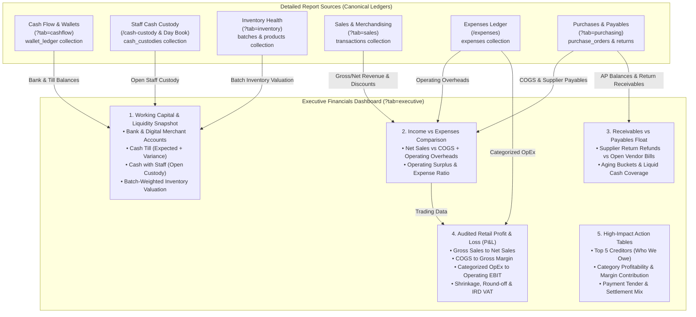
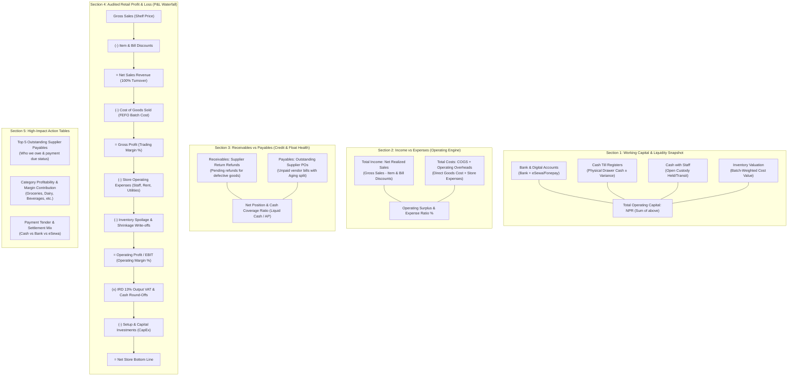
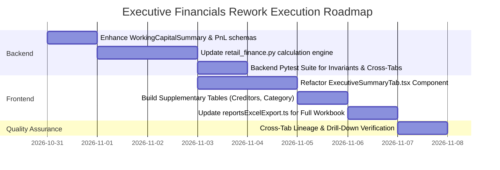

# Executive Financials & Reports Rework Plan

**Document Version:** 1.0  
**Target Module:** Retail Reports & Executive Financial Intelligence  
**Author / Architect:** Antigravity AI Engineering  
**Status:** Under Review  

---

## 1. Executive Summary & Objective

The **Executive Financials** report serves as the single source of truth for store owners, general managers, and finance teams to evaluate the true financial health of KoMart. 

The objective of this rework is to:
1. **Eliminate fragmentation and confusion** by consolidating scattered figures into a unified, executive-grade dashboard.
2. **Guarantee absolute accounting accuracy** by sourcing each metric directly from canonical ledgers without redundancy or double counting.
3. **Address real-world supermarket operational gaps** (cash-in-transit, digital merchant wallets, till shortages, supplier aging, and inventory shrinkage).
4. **Provide clear lineage and deep links** back to the specialized report tabs (`Sales & Merchandising`, `Purchases & Payables`, `Inventory Health`, `Cash Flow & Liquidity`, and `Loss & Audit`).

---

## 2. Business Gap Analysis & Audited Solutions

| # | Business Gap / Pitfall in Supermarket Operations | Impact on Reporting | Audited Solution |
|---|---|---|---|
| **1** | **Period-End vs. Live Balance Mismatch** | If viewing last month's report, displaying *today's* live bank/till balance gives a false picture of historical capital. | **Dual Snapshot Mode**: The Working Capital section presents **Period Closing Balances** (as of the selected `endDate`) alongside a **Live Today** indicator. |
| **2** | **Omission of Digital Wallets (eSewa / Fonepay)** | In Nepal, 30–45% of customer turnover is paid via Fonepay / eSewa QR. Omitting merchant wallets severely understates liquid assets. | Group under **Bank & Digital Merchant Accounts** with individual sub-balances for Bank and eSewa. |
| **3** | **Expense Redundancy & Double-Counting** | Entering supplier payments in both `/expenses` (e.g. `purchase_order`) and PO modules causes expenses to be counted twice. | **Strict Capital Segregation**: <br>• **COGS**: Items sold × batch purchase price.<br>• **OpEx**: Ledger expenses strictly excluding `purchase_order` (inventory) and `setup_investment` (CapEx).<br>• CapEx is isolated below Operating EBIT. |
| **4** | **Unbatched / Missing Cost Price Fallback** | Scanned items missing an active batch cost can default to zero, artificially creating a 100% phantom profit margin. | **Two-Tier Cost Fallback**: Batch FEFO cost $\to$ Master Product Cost Price $\to$ Last Supplier PO purchase price, preventing phantom margins. |
| **5** | **Till Cash Shortages / Overages (Register Leaks)** | Physical cash counted in the till at night frequently differs from computer-expected cash due to change errors or theft. | Surface **Net Till Reconciliation Variance (Over/Short)** directly alongside Cash Till to immediately reveal register discrepancies. |
| **6** | **Inventory Spoilage, Expiry & Shrinkage** | Expired perishables (dairy, produce) or broken items written off represent lost capital, not regular sales. | Feature **Inventory Shrinkage & Write-offs** as an explicit deduction after Gross Profit to ensure operating profit is not overstated. |

---

## 3. High-Level Architecture & Information Lineage



### 3.2 Dashboard UI Layout & Financial Flowchart



---

## 4. Detailed Section Specifications

### Section 1: Working Capital & Liquidity Snapshot
*Answers: "Where is our operating capital right now, and how liquid are we?"*

* **Components**:
  1. **Bank & Digital Accounts**:
     - Operating bank account balance (Nabil / Global IME / etc.).
     - Digital merchant wallets (eSewa / Fonepay merchant accounts).
     - *Source:* `wallet_ledger` entries up to period end (`Wallet.bank`, `Wallet.esewa`).
  2. **Cash Till (Cash in Hand)**:
     - Expected drawer cash balance across all active registers.
     - Till reconciliation note showing net count variance ($+/-$ over/short).
     - *Source:* `day_close` records + `wallet_ledger` (`Wallet.cash`).
  3. **Cash with Staff (Custody Float)**:
     - Cash temporarily held by staff members for emergency local procurement, transport, or pending bank deposit.
     - *Source:* `CashCustody` records where `status == "held"`.
  4. **Inventory Valuation**:
     - Real-time asset valuation of all on-shelf and backroom merchandise at cost.
     - Formula: $\sum (\text{batch.current\_stock} \times \text{batch.purchase\_price})$.
     - *Source:* Active inventory batches from `InventoryHealthTab`.
* **Summary Banner**:
  - **Total Working Assets** = $\text{Bank} + \text{Till} + \text{Staff Custody} + \text{Inventory Valuation}$.
  - **Quick Cash Coverage Ratio**: $(\text{Bank} + \text{Till} + \text{Staff Custody}) / \text{Accounts Payable}$. Tells the owner how many times liquid funds cover pending bills.
* **Deep Links**:
  - `[Inspect Wallets & Cash Flow →]` (switches to `?tab=cashflow`).
  - `[View Inventory Valuation Details →]` (switches to `?tab=inventory`).

---

### Section 2: Income vs Expenses Comparison
*Answers: "Are we making more than we spend, and where is our money leaking?"*

* **Components**:
  - **Total Operating Income (Revenue)**:
    - **Gross Shelf Sales**: Sticker price of all scanned goods.
    - **Customer Discounts**: Sum of item markdowns and bill-level loyalty discounts.
    - **Net Sales Revenue**: Realized revenue from store sales.
    - *Source:* `SalesPerformanceReport` (`?tab=sales`).
  - **Total Operating Costs**:
    - **Cost of Goods Sold (COGS)**: Direct acquisition cost of goods sold during the period.
    - **Store Operating Overheads (OpEx)**: Staff payroll, store rent, electricity, municipality taxes, packaging, and maintenance.
    - *Source:* Filtered `expenses` ledger (excluding CapEx and PO payments).
  - **Comparison Card & Key Indicators**:
    - Visual side-by-side gauge of Revenue vs. Total Costs.
    - **Operating Surplus**: $\text{Net Sales} - (\text{COGS} + \text{OpEx})$.
    - **Cost-to-Income Ratio (%)**: Percentage of revenue absorbed by costs.
* **Deep Links**:
  - `[View Sales & Merchandising →]` (switches to `?tab=sales`).
  - `[Manage Expenses Ledger →]` (navigates to `/expenses`).

---

### Section 3: Receivables vs Payables Float
*Answers: "Who owes us money, who do we owe, and do we have enough cash to stay solvent?"*

* **Components**:
  - **Receivables (Assets Owed to Us)**:
    - **Supplier Return Refunds**: Cash or credit notes owed by vendors for expired/defective items returned to them.
    - Formula: $\sum (\text{return.total\_amount} - (\text{return.amount\_received} + \text{return.write\_off\_amount}))$.
    - *Source:* `PurchaseReturn` records with status `requested`.
  - **Payables (Liabilities Owed by Us)**:
    - **Accounts Payable (AP)**: Outstanding balances on confirmed and received purchase orders.
    - Formula: $\sum (\text{po.total\_amount} - \text{po.amount\_paid})$.
    - **Aging Breakdown**:
      - Current (0–30 days)
      - Due (31–60 days)
      - Overdue (61–90 days)
      - Critical (90+ days)
    - *Source:* `PurchasingPayablesReport` (`?tab=purchasing`).
  - **Net Working Obligation**:
    - $\text{Net Float} = \text{Receivables} - \text{Payables}$.
    - Status badge: *Net Creditor* (positive) vs *Net Debtor* (negative).
* **Deep Link**:
  - `[Open Supplier Accounts Payable Ledger →]` (switches to `?tab=purchasing`).

---

### Section 4: Audited Retail Profit & Loss (P&L) Statement
*Answers: "What is the true accounting profit after cost of sales and all store expenses?"*

* **Multi-Step Statement Structure**:

```text
========================================================================
1. GROSS SALES REVENUE (Shelf Price of Goods Scanned)          NPR  X,XXX,XXX.XX
   (-) Item Markdown Discounts                               (NPR    XX,XXX.XX)
   (-) Bill & Loyalty Promotional Discounts                   (NPR    XX,XXX.XX)
------------------------------------------------------------------------
2. NET SALES REVENUE (Baseline Turnover 100%)                  NPR  X,XXX,XXX.XX

   (-) Cost of Goods Sold (FEFO Batch Cost of Items Sold)     (NPR  X,XXX,XXX.XX)
------------------------------------------------------------------------
3. GROSS PROFIT (Trading Margin)                               NPR    XXX,XXX.XX
   Gross Margin %: XX.X%

   (-) Store Operating Overheads (OpEx)
       • Staff Salaries & Allowances                          (NPR    XX,XXX.XX)
       • Store Rent & Lease                                   (NPR    XX,XXX.XX)
       • Electricity, Water & Internet                        (NPR    XX,XXX.XX)
       • Packaging & Consumables                              (NPR     X,XXX.XX)
       • Maintenance, Repairs & Waste Disposal                (NPR     X,XXX.XX)
       • Other Operational Overheads                          (NPR     X,XXX.XX)
   (-) Inventory Spoilage & Shrinkage Write-offs              (NPR     X,XXX.XX)
------------------------------------------------------------------------
4. OPERATING PROFIT / EBIT (Earnings Before Interest & Taxes)  NPR    XXX,XXX.XX
   Operating Margin %: XX.X%

   (±) Non-Operating Cash Adjustments:
       • IRD 13% Output VAT Collected                         (NPR    XX,XXX.XX)
       • Cash Currency Round-Off Adjustments                   NPR       ±XXX.XX
       • Store Internal Use (Non-Cash Consumption)            +NPR      X,XXX.XX
   (-) Setup & Capital Investments (CapEx)                    (NPR    XX,XXX.XX)
------------------------------------------------------------------------
5. NET STORE EARNINGS                                          NPR    XXX,XXX.XX
========================================================================
```

---

### Section 5: High-Impact Action Tables (Supplementary Reports)

To make the Executive Financials tab self-contained for managerial decisions, three curated tables are embedded at the bottom:

#### Table 1: Top 5 Outstanding Supplier Payables (Creditors)
*Purpose:* Identifies the largest pending liabilities to prioritize cash disbursements.
* *Columns:* Supplier Name, Contact Phone, Total PO Orders, Amount Paid, **Current Balance Due**, Aging Status (e.g., 15 days, 45 days overdue).
* *Action:* One-click "Pay Supplier" link opening the PO settlement dialog.

#### Table 2: Category Profitability & Margin Contribution
*Purpose:* Shows which departments are driving earnings versus eroding margin through high discounts.
* *Columns:* Department/Category, Units Sold, Net Revenue, COGS, **Gross Profit**, **Gross Margin %**, Revenue Share %, Profit Share %.

#### Table 3: Payment Tender & Settlement Mix
*Purpose:* Audit register cash against digital gateway settlements to detect bank deposit delays or till shortages.
* *Columns:* Payment Method (Cash, Fonepay QR, eSewa, Card), Bills Count, Total Collected, Share %, Settlement Account.

---

## 5. Data Flow & Testing Verification Plan

To guarantee mathematical consistency, zero redundancy, and full auditability:

### Invariant Mathematical Checks (Automated Unit Tests)
1. **P&L Turnover Integrity**:
   $$\text{Gross Sales} - \text{Item Discounts} - \text{Bill Discounts} \equiv \text{Net Sales}$$
2. **Gross Margin Integrity**:
   $$\text{Net Sales} - \text{Total COGS} \equiv \text{Gross Profit}$$
3. **Operating Profit Integrity**:
   $$\text{Gross Profit} - \text{Operating Expenses} - \text{Shrinkage} \equiv \text{Operating EBIT}$$
4. **Cash Movement Integrity**:
   $$\text{Opening Cash/Bank} + \text{Total Inflows} - \text{Total Outflows} \equiv \text{Closing Balances}$$
5. **No Double-Counting Assertion**:
   - Assert `purchase_order` category in `expenses` is NEVER added to Operating Expenses.
   - Assert `setup_investment` is NEVER included in Operating EBIT.
   - Assert voided transactions and cancelled orders are excluded from revenue.

### Cross-Tab Consistency Tests
- Assert `executive_summary.pnl.net_sales == sales_performance.net_sales`.
- Assert `executive_summary.working_capital.inventory_value == inventory_health.total_inventory_value`.
- Assert `executive_summary.working_capital.accounts_payable == purchasing_payables.total_outstanding_ap`.
- Assert `executive_summary.working_capital.accounts_receivable == purchasing_payables.total_supplier_receivables`.

---

## 6. Implementation Roadmap



### Next Steps
1. Review and finalize this specification document.
2. Begin Step 1: Backend schema updates in `backend/app/schemas/reports.py` and service calculation in `backend/app/services/retail_finance.py`.
3. Proceed to Frontend UI overhaul and integration tests.

